# TNPSC99 — Current Affairs Intelligence Engine Architecture
**Document Version:** 1.0.0  
**Phase:** CA-1 Architecture and Source Ingestion  
**Status:** Approved Architectural Specification  
**Branch:** `feature/current-affairs-engine`

---

## 1. System Vision & Guiding Principles

The **TNPSC99 Current Affairs Intelligence Engine** is an end-to-end, high-accuracy, bilingual (Tamil & English) knowledge harvesting, verification, and examination generation system. Designed specifically for Tamil Nadu Public Service Commission (TNPSC) aspirants across Group I, Group II/IIA, and Group IV examinations, the engine prioritizes:

1. **Official-Source Traceability Over Volume:** No question is ever generated without strict cryptographic and citation anchoring to official Government releases (TN DIPR, GoI PIB, RBI, ISRO, Supreme Court / Madras High Court judgments, Gazette notifications).
2. **Bilingual Parity:** Both English and Tamil formulations are treated as first-class citizens with aligned terminology, verified against Tamil Nadu Government standard glossaries (*செந்தமிழ்ச் சொற்பிறப்பியல் பேரகரமுதலி* and official departmental Tamil releases).
3. **Deterministic Factual Extraction:** AI is utilized as an assistant for structural extraction, drafting, and cross-referencing, but **never** as an autonomous, unverified source of truth. Factual claims are isolated into atomic propositions and validated against primary source text.
4. **Integration with Existing TNPSC99 Ecosystem:** Seamlessly leverages the established Practice Mode, server-authoritative Exam Mode (`/api/test/submit`), Mistake Vault 3-stage spaced repetition (`unresolved` $\rightarrow$ `revised` $\rightarrow$ `mastered`), and ₹99 subscription gate without disrupting production stability.

---

## 2. End-to-End Pipeline Architecture

The Current Affairs pipeline consists of six sequential, audited stages:

```mermaid
flowchart TD
    subgraph S1["Stage 1: Source Ingestion"]
        A1["Authoritative Sources<br>(TN DIPR, PIB, RBI, ISRO)"] --> A2["Ingestion Adapter<br>(RSS / HTML / PDF Scraper)"]
        A2 --> A3["Document Normalizer & Hasher<br>(SHA-256 Checksum, De-duplication)"]
        A3 --> A4[("Firestore: ca_raw_documents")]
    end

    subgraph S2["Stage 2: Event Extraction & Syllabus Mapping"]
        A4 --> B1["Atomic Event Extractor<br>(Event Date vs Pub Date)"]
        B1 --> B2["TNPSC Syllabus Classifier<br>(TN Specific, National, Economy, Sci-Tech)"]
        B2 --> B3["Exam Relevance Ranker<br>(Group I, Group II/IIA, Group IV)"]
        B3 --> B4[("Firestore: ca_events & ca_facts")]
    end

    subgraph S3["Stage 3: Bilingual Question Drafting"]
        B4 --> C1["Genkit Bilingual MCQ Generator<br>(Tamil & English Parallel Synthesis)"]
        C1 --> C2["Plausible Distractor Generator<br>(Targeting Common Aspirant Misconceptions)"]
        C2 --> C3["Explanation & Citation Builder<br>(Primary Source Excerpt & Reference URL)"]
        C3 --> C4[("Firestore: ca_draft_questions")]
    end

    subgraph S4["Stage 4: Automated Verification & Validation Gate"]
        C4 --> D1["Adversarial Fact Check<br>(Claim Verification against Raw Doc)"]
        D1 --> D2["Option Unambiguity Verifier<br>(Single Correct Key Guarantee)"]
        D2 --> D3["Tamil-English Consistency Check<br>(Term Alignment & Semantic Equivalence)"]
        D3 --> D4{Passed All Gates?}
        D4 -- No --> D5["Rejected / Remediation Queue"]
        D4 -- Yes --> D6[("Firestore: ca_verified_questions")]
    end

    subgraph S5["Stage 5: Editorial Governance & Publishing Gate"]
        D6 --> E1["Admin Editorial Workbench<br>(Human Review, Edit, Approve)"]
        E1 --> E2["Publishing Manifest Builder<br>(Daily 10-Q, Weekly 50-Q, Monthly 100-Q)"]
        E2 --> E3["Production Release Promotion<br>(Atomic Migration to 'tests' & 'questions')"]
        E3 --> E4[("Production Firestore: tests & questions")]
    end

    subgraph S6["Stage 6: Student Experience & Feedback Loop"]
        E4 --> F1["TNPSC99 Practice & Exam Engine<br>(Authoritative Scoring)"]
        F1 --> F2["Mistake Vault & Spaced Repetition"]
        F1 --> F3["Student Flag / Peer Review Queue<br>(Retraction & Notification System)"]
    end
```

---

## 3. Existing TNPSC99 Architecture Audit & Reusable Components

| Existing Component | File / Location | Capabilities | Reusability for Current Affairs |
| :--- | :--- | :--- | :--- |
| **Data Models** | `src/lib/types.ts` | `Question`, `Test`, `UserTestAttempt`, `Score` | Reused directly as final output format. Current Affairs questions conform 100% to standard `Question` schema. |
| **Exam & Practice Engine** | `src/lib/test-service.ts`, `src/app/(app)/test/` | Timer countdown, answer persistence, question navigation, review flag | Native support for Daily/Weekly Current Affairs tests without code alterations. |
| **Server-Authoritative Submission** | `src/app/api/test/submit/route.ts` | Tamper-proof scoring, deadline enforcement, Mistake Vault synchronization | Automatically scores Current Affairs tests and auto-populates student Mistake Vaults on incorrect responses. |
| **Mistake Vault State Machine** | `src/lib/mistake-vault-service.ts` | 3-stage mastery (`unresolved` $\rightarrow$ `revised` $\rightarrow$ `mastered`) | Ensures current affairs questions answered incorrectly are systematically revisited by aspirants. |
| **AI Framework** | `src/ai/genkit.ts`, `src/ai/flows/` | Genkit with Gemini 1.5 Flash (`@genkit-ai/googleai`) | Extended with structured input/output schemas for bilingual extraction, fact-checking, and MCQ drafting. |
| **Subscription & Auth Gate** | `src/lib/server-payment.ts`, `src/lib/subscription.ts` | ₹99 monthly pass gating, Firebase Auth ID token verification | Daily current affairs tests can be tiered (e.g., current day free preview, weekly/monthly consolidated tests restricted to ₹99 subscribers). |
| **Admin Portal** | `src/app/(app)/admin/` | Question management, syllabus management, user management | Dedicated `/admin/current-affairs` workbench added for editorial review and publishing manifests. |

---

## 4. Architectural Boundaries and Safety Controls

1. **Isolation from Production Collections:**
   All ingestion, extraction, drafting, and verification operations occur in dedicated Firestore staging collections prefixed with `ca_`:
   - `ca_sources`: Source registry metadata and configuration
   - `ca_raw_documents`: Immutable raw snapshots with SHA-256 hashes
   - `ca_events`: Structured factual events with syllabus mapping
   - `ca_facts`: Atomic verifiable claims extracted from events
   - `ca_draft_questions`: Candidate MCQs in drafting and automated review
   - `ca_verified_questions`: Questions that have passed automated verification
   - `ca_manifests`: Curated daily, weekly, and monthly test packages
   - `ca_audit_logs`: Immutable ledger of every ingestion, edit, approval, and retraction

2. **Zero Direct Unreviewed Writes to Production:**
   Promoting a question from `ca_verified_questions` into the production `questions` and `tests` collections requires an explicit editorial approval action signed by an authenticated admin UID.

3. **Retraction and Student Impact Management:**
   If a published question is discovered to have a factual error or conflicting official key:
   - The question is marked `retracted` with an explanatory notice and corrected key.
   - Any historical attempt in `testAttempts` containing this question has its score recalculation queued.
   - If the student was penalized in the Mistake Vault, the question is neutralized or re-presented for practice.
   - An in-app notification is posted to all affected students.
