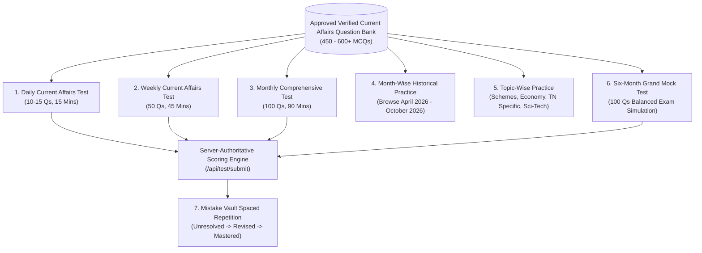

# TNPSC99 — Six-Month Historical Backfill & Continuous Engine Architecture
**Document Version:** 1.1.0  
**Phase:** CA-1 Extension / CA-2 Bridge  
**Status:** Approved Operational Specification  
**Branch:** `feature/current-affairs-engine`

---

## 1. Context & Examination Horizon

With TNPSC examinations (Group I / Group II-IIA / Group IV) scheduled within approximately three months, aspirants require both:
1. **Six-Month Historical Backfill:** Comprehensive, verified, bilingual current affairs coverage spanning **23 April 2026 to 23 October 2026** (~450 to 600 MCQs total; target 75–100 MCQs per full month).
2. **Continuous Daily Ingestion & Publication:** Ongoing daily harvesting, fact extraction, drafting, verification, and editorial publishing extending seamlessly into the future.
3. **Non-Destructive Rolling Retention:** The 6-month window rolls forward daily for standard mock tests, but **never deletes historical verified content**. Older months remain archived in historical month-wise practice pools so students preparing for any examination cycle can access past coverage.

---

## 2. Six-Month Monthly Partitioning Matrix (23 April 2026 – 23 October 2026)

| Month ID | Temporal Scope | Primary Official Milestones & Government Events | Target Verified MCQs | Manifest Type |
| :--- | :--- | :--- | :---: | :--- |
| **M1: 2026-04/05** | 23 Apr 2026 – 22 May 2026 | GoTN New Welfare Scheme Notifications, State Agricultural Budget Highlights, RBI MPC Policy, ISRO Earth Observation updates | 75–100 | `manifest_monthly_2026_05` |
| **M2: 2026-05/06** | 23 May 2026 – 22 Jun 2026 | Tamil Nadu Industrial Policy Updates, Naan Mudhalvan Skill Conclave, State Environmental Reports, Padma / Kalaimamani Awards | 75–100 | `manifest_monthly_2026_06` |
| **M3: 2026-06/07** | 23 Jun 2026 – 22 Jul 2026 | School Education Breakfast Scheme Expansion, Keeladi Phase X Excavations, Monsoon Preparedness, Union Economic Survey excerpts | 75–100 | `manifest_monthly_2026_07` |
| **M4: 2026-07/08** | 23 Jul 2026 – 22 Aug 2026 | Union Budget 2026 Highlights, State SDG Index Rankings, Independence Day State Medals, Chandrayaan / Gaganyaan Milestones | 75–100 | `manifest_monthly_2026_08` |
| **M5: 2026-08/09** | 23 Aug 2026 – 22 Sep 2026 | Kalaignar Magalir Urimai Thittam Phase II additions, Madras High Court Landmark Rulings, State Sports Policy & Asian Games trials | 75–100 | `manifest_monthly_2026_09` |
| **M6: 2026-09/10** | 23 Sep 2026 – 23 Oct 2026 | Gandhi Jayanti Awards, State Renewable Energy Corridors, Nobel Prizes (Indian/Global relevance), Recent TN Cabinet Decisions | 75–100 | `manifest_monthly_2026_10` |
| **Total 6-Month Baseline** | **23 April 2026 – 23 October 2026** | **All 9 TNPSC Current Affairs Syllabus Categories** | **450–600 MCQs** | **`manifest_grand_mock_6m_2026`** |

---

## 3. Seven Core Student Modules

The engine powers seven distinct learning and testing modes, reusing the native TNPSC99 Practice Mode, Exam Mode, server-authoritative scoring (`/api/test/submit`), and 3-stage Mistake Vault:



### Module Specifications
1. **Daily Current Affairs Test (10–15 MCQs):** Published daily at 07:00 IST. Free for all aspirants for 7 days to drive organic adoption.
2. **Weekly Current Affairs Test (50 MCQs):** Published every Sunday. Consolidates the top verified questions from the preceding week.
3. **Monthly Current Affairs Test (100 MCQs):** Comprehensive 100-question timed exam published on the 1st of each month. Restricted to ₹99/mo subscribers.
4. **Month-Wise Historical MCQ Practice:** Self-paced practice mode allowing students to select any month (e.g., *May 2026*, *July 2026*) with immediate answer revelations and bilingual explanations.
5. **Topic-Wise Current Affairs Practice:** Category-filtered practice across the entire 6-month bank (e.g., *All Tamil Nadu Welfare Schemes*, *All Science & Technology*).
6. **Six-Month Grand Mock Test (100 MCQs):** Full 100-question exam simulating the official TNPSC General Studies Current Affairs paper, proportionately sampled across all 6 months and all 9 syllabus domains.
7. **Mistake Vault Integration:** Any missed current affairs question is automatically entered into the student's personal Mistake Vault (`users/{userId}/mistakeVault/{questionId}`). Mastery requires two consecutive correct attempts in revision mode.

---

## 4. Canonical Question ID Reuse & De-Duplication Architecture

A critical architectural requirement is that **weekly, monthly, and grand mock tests DO NOT create duplicate question documents**. 

- Every drafted and approved question is stored **once** with a permanent, canonical `questionId` in `ca_draft_questions` (and promoted to production `questions`).
- Weekly and monthly tests are structured as **manifests** (`CAManifest`) containing ordered arrays of canonical `questionIds`:
  $$\text{Manifest}_{\text{Monthly}} = \{ \text{id}: \text{"manifest\_2026\_10"}, \text{questionIds}: [q_1, q_4, q_{17}, \dots, q_{982}] \}$$
- This guarantees:
  1. Zero storage duplication in Firestore.
  2. A student's Mistake Vault entry for question $q_{17}$ is linked to the same entity whether the student failed it in a Daily Test, a Weekly Test, or the Grand Mock.
  3. A single correction or retraction to $q_{17}$ automatically updates all referencing tests simultaneously.

---

## 5. Non-Destructive Erratum & Retraction Governance

If an official answer key is modified by a government gazette erratum or an ambiguity is identified:

1. **Versioned Record:** The question entity maintains an audit trail array `correctionHistory`:
   ```typescript
   correctionHistory: [
     {
       correctedAt: "2026-10-23T18:00:00Z",
       previousCorrectAnswer: "Option B",
       newCorrectAnswer: "Option C",
       reason: "TN DIPR Erratum bulletin issued on 23-Oct regarding revised scheme budget allocation.",
       adminUid: "admin_verified_01"
     }
   ]
   ```
2. **Zero Silent Score Alterations:**
   - Completed historical student attempts in `testAttempts` are **never silently rewritten**.
   - An asynchronous impact-assessment job identifies all students who answered the retracted question.
   - Per standard TNPSC examination conventions, marks are awarded to all candidates for defective questions (*full bonus marks awarded*), or the question is neutralized.
   - An explanatory notification is posted to affected students' notification feeds.

---

## 6. Comprehensive Cost Model: 6-Month Backfill + Daily Operations

### 6.1 Historical Backfill Cost (One-Time Execution)
- Target: 600 verified MCQs (derived from ~1,200 candidate raw events across 6 months).
- Ingestion & Scraping: 1,500 historical releases = **₹0.00** (within free tier).
- AI Fact Extraction (Gemini 1.5 Flash): 1,200 events $\times$ 3,000 prompt tokens = 3.6M input tokens = **~₹23.00**.
- AI Bilingual MCQ Drafting: 600 approved MCQs (from ~900 drafts) $\times$ 1,200 output tokens = 1.08M output tokens = **~₹27.00**.
- Automated Adversarial Fact Checking & Verification: 900 checks $\times$ 1,500 tokens = 1.35M input tokens = **~₹8.50**.
- **Total Estimated One-Time Backfill Cost:** **~₹58.50 (less than \$0.75 USD)**.

### 6.2 Ongoing Monthly Operations (Base Plan: 300 MCQs / month)
- Daily ingestion of 25 articles $\times$ 30 days = 750 articles / month.
- Monthly AI processing + verification cost: **~₹143.00 / month**.
- Total annual cloud AI & operational spend: **~₹1,774.50 / year**.
- Highly sustainable: Covered by less than two ₹99 monthly student subscriptions per year.
