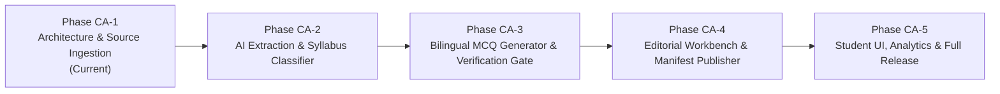

# TNPSC99 — Current Affairs Implementation Roadmap & Cost Modeling
**Document Version:** 1.0.0  
**Phase:** CA-1 Architecture and Source Ingestion  
**Status:** Approved Operational & Budget Plan  
**Branch:** `feature/current-affairs-engine`

---

## 1. Phased Implementation Roadmap

| Phase | Core Objective | Key Deliverables | Estimated Schedule |
| :--- | :--- | :--- | :--- |
| **Phase CA-1** | Architecture & Source Ingestion *(Current)* | Architectural design, source registry, Firestore data models, verification policy, ingestion adapters, local test suite | Immediate |
| **Phase CA-2** | AI Extraction & Syllabus Classifier | Genkit extraction flows, atomic factual claim parser, syllabus taxonomy classifier, entity recognizer | Next Iteration |
| **Phase CA-3** | Bilingual MCQ Generator & Verification Gate | Parallel Tamil/English drafting, adversarial fact-checking gate, key unambiguity solver, distractor validator | Following Iteration |
| **Phase CA-4** | Editorial Workbench & Manifest Publisher | Admin review UI, one-click manifest compiler (Daily 10-Q, Weekly 50-Q, Monthly 100-Q), retraction engine | Following Iteration |
| **Phase CA-5** | Student Experience & Tiered Access | Public daily preview, ₹99 subscriber weekly/monthly vaults, Mistake Vault auto-routing, performance analytics | Final Release |

---

## 2. Operational Cost Modeling & Resource Estimates

### 2.1 Unit Pricing Baseline (Google Cloud & Gemini 1.5 Flash)
- **Gemini 1.5 Flash (via Genkit):**
  - Input tokens: \$0.075 per 1,000,000 tokens (approx. ₹6.30 per 1M tokens)
  - Output tokens: \$0.30 per 1,000,000 tokens (approx. ₹25.20 per 1M tokens)
- **Cloud Run Jobs / Cloud Scheduler:** Free tier covers up to 3 jobs/month and 2M requests/month.
- **Firestore Operations:**
  - Reads: \$0.06 per 100,000 reads
  - Writes: \$0.18 per 100,000 writes
  - Storage: First 1 GB free, then \$0.18/GB/month
- **Cloud Storage (PDFs & Snapshots):** First 5 GB free, then \$0.026/GB/month

---

### 2.2 Volume Scenarios (Monthly Projections)

| Metric | Conservative Scenario | Base Recommended Scenario | High-Volume Expansion Scenario |
| :--- | :--- | :--- | :--- |
| **Monitored Source Feeds** | 5 primary feeds | 10 official feeds | 25 feeds (incl. regional district bulletins) |
| **Raw Articles Ingested / Month** | 300 articles | 750 articles | 2,000 articles |
| **Factual Events Extracted** | 150 events | 400 events | 1,000 events |
| **Candidate MCQs Drafted** | 300 MCQs | 800 MCQs | 2,500 MCQs |
| **Approved MCQs Published** | **150 MCQs** (5/day) | **300 MCQs** (10/day) | **600 MCQs** (20/day) |
| **Average Input Tokens / Event** | ~2,500 tokens | ~3,500 tokens | ~4,500 tokens |
| **Average Output Tokens / Event** | ~800 tokens | ~1,000 tokens | ~1,200 tokens |

---

### 2.3 Monthly Cost Breakdown (in INR ₹)

| Cost Component | Conservative (₹) | Base Plan (₹) | High-Volume (₹) | Notes |
| :--- | :---: | :---: | :---: | :--- |
| **Source Ingestion & Scraping** | ₹0.00 | ₹0.00 | ₹50.00 | Free tier Cloud Run covers compute |
| **Raw Document Storage (GCS)** | ₹0.00 | ₹0.00 | ₹15.00 | Within GCS 5 GB free allocation |
| **AI Extraction & Categorization** | ₹12.50 | ₹35.00 | ₹110.00 | Gemini 1.5 Flash prompt tokens |
| **AI Bilingual MCQ Generation** | ₹18.00 | ₹48.00 | ₹165.00 | Parallel English + Tamil generation |
| **Adversarial Verification Gate** | ₹14.00 | ₹38.00 | ₹125.00 | Blind solver + source validation queries |
| **Firestore Database I/O** | ₹8.00 | ₹22.00 | ₹65.00 | Staging writes, verified promotes, reads |
| **Cloud Scheduler Orchestration** | ₹0.00 | ₹0.00 | ₹0.00 | Within Cloud Scheduler 3 free jobs |
| **Total Estimated Monthly Cost** | **₹52.50 / mo** | **₹143.00 / mo** | **₹530.00 / mo** | **Extremely cost-effective** |

> [!NOTE]
> Even under the **High-Volume Expansion Scenario**, the entire current affairs intelligence engine consumes only **~₹530 per month** (less than the revenue from 6 subscriber fees at ₹99/month). Under the **Base Plan**, monthly cost is under **₹150**.

---

## 3. Enforceable Budget Caps & Safety Circuit Breakers

To guarantee zero runaway cloud bills:

1. **Daily AI Request Quota:**
   - Soft alert threshold: 100 LLM calls per 24 hours.
   - Hard circuit breaker: 250 LLM calls per 24 hours (pipeline automatically pauses drafting and notifies admin if breached).
2. **Maximum Document Payload Cap:**
   - Raw HTML/PDF ingestion rejects single payloads larger than 15 MB.
3. **Monthly Budget Alert in Google Cloud Console:**
   - Programmed alert at **\$10.00 (~₹840)** with webhook trigger that automatically stops non-essential background Cloud Run jobs if threshold is approached.
