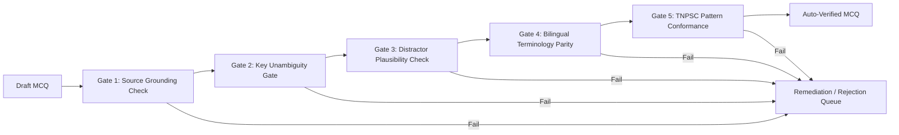

# TNPSC99 — Current Affairs Verification & Publishing Policy
**Document Version:** 1.0.0  
**Phase:** CA-1 Architecture and Source Ingestion  
**Status:** Approved Quality & Governance Standard  
**Branch:** `feature/current-affairs-engine`

---

## 1. Zero-Hallucination Mandate & Non-Reliance on AI Confidence Scores

In standard LLM operations, "confidence scores" or log probabilities represent statistical likelihood of token generation, **not factual truth**. In competitive government exams like TNPSC where a single contested mark alters civil service ranking:

1. **AI Confidence Scores are Explicitly Disallowed as Proof of Factual Correctness.**
2. **Every Factual Claim Must Be Grounded in Extracted Raw Source Excerpts.**
3. If an extracted claim cannot be found verbatim or by direct semantic entailment within the raw ingested document (`ca_raw_documents`), it is immediately classified as **unverified** and prohibited from question drafting.

---

## 2. Multi-Stage Automated Verification Gates

Before any candidate MCQ reaches the human editorial queue, it must pass five independent automated gates:

### Gate 1: Source Grounding & Direct Citation
- The proposed correct answer and explanation must have an explicit sentence-level citation (`sourceExcerpt`) to the raw document.
- The system executes an adversarial verification query: *"Given ONLY the provided text excerpt, does it strictly prove that Option [K] is true and all other options are false?"* If ambiguity exists, the question is rejected.

### Gate 2: Key Unambiguity & Negative Verification
- The draft question is sent through a blind-solver model without the answer key.
- The solver must independently arrive at the exact same key.
- If the solver identifies that two options could both be considered valid under different interpretations, the question is rejected for **key ambiguity**.

### Gate 3: Distractor Quality & Anti-Triviality Check
- All 3 distractors must be plausible alternatives belonging to the same semantic class (e.g., if the key is a scheme name, distractors must be other active TN/Central schemes, not fabricated names).
- Options like "None of the above" or "All of the above" are restricted to a maximum of 5% of questions, conforming to modern TNPSC Group I/II standards.

### Gate 4: Bilingual Semantic Equivalence Check
- Questions, options, and explanations in English and Tamil are checked for semantic parity.
- Technical, economic, and administrative terms in Tamil must match official Tamil Nadu Government terminology:
  - Example: *Kalaignar Magalir Urimai Thittam* $\leftrightarrow$ கலைஞர் மகளிர் உரிமைத் திட்டம்
  - Example: *Gross State Domestic Product (GSDP)* $\leftrightarrow$ மாநில மொத்த உள்நாட்டு உற்பத்தி
- Number formatting, dates, percentages, and amounts must match exactly between language versions.

### Gate 5: TNPSC Exam Pattern Conformance
- Group I questions require multi-statement formats (*"Which of the statements given above is/are correct?"*).
- Group II/IIA emphasizes constitutional provisions, scheme objectives, and statutory mandates.
- Group IV focuses on direct, unambiguous factual recall suitable for the 10th standard qualification baseline.

---

## 3. Human Editorial Governance Workflow

Automated verification is a prerequisite, but **never a sufficient condition** for public release. The human editorial workflow enforces accountability:

1. **Editorial Review Dashboard:**
   - Editors inspect the proposed question side-by-side with the raw government press release excerpt and the highlighted sentence.
   - Editors verify that the question is culturally sensitive, non-partisan, and directly aligned with the TNPSC syllabus.
2. **One-Click Corrections:**
   - Editors can edit options, refine Tamil translation nuances, or adjust difficulty ratings.
3. **Admin Sign-Off:**
   - Publishing a daily manifest requires an authenticated Admin signature. The Admin UID is recorded immutably in `ca_manifests` and `ca_audit_logs`.

---

## 4. Retraction, Correction & Student Impact Protocol

In the event that an error is discovered in a published Current Affairs question (e.g., subsequent government clarification or erratum):

1. **Immediate Retraction:**
   - Admin marks the question status as `retracted` in `questions`.
   - The question is removed from active practice pools to prevent further student confusion.
2. **Affected-Attempt Audit:**
   - The engine queries all `testAttempts` records in Firestore referencing the retracted question ID.
3. **Score Recalculation:**
   - For all affected attempts:
     - The question is awarded full marks to all candidates (Standard TNPSC Erratum Protocol: *Marks awarded to all aspirants*), OR
     - The total possible score is adjusted downwards by 1.
4. **Mistake Vault Neutralization:**
   - Any student who was penalized in their Mistake Vault (`users/{userId}/mistakeVault/{questionId}`) has the failure neutralized so it does not corrupt their mastery score.
5. **Transparency Notification:**
   - An in-app alert is dispatched to affected students explaining the source discrepancy and detailing the score adjustment.
