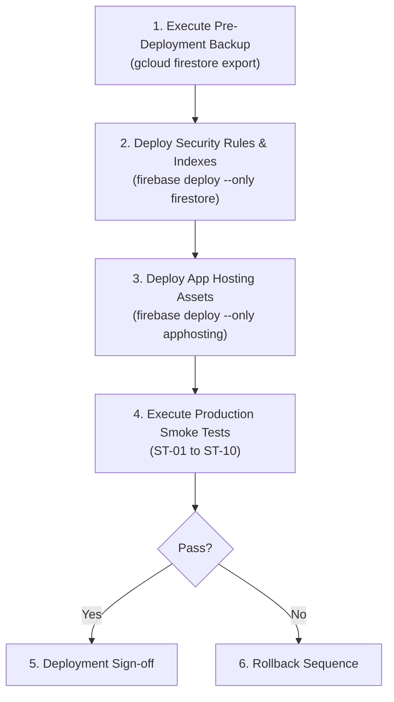

# TNPSC99 — Final Release Candidate Freeze & Verification Dossier

**Release Tag:** `v1.0.0-rc.1`  
**Commit SHA:** `f58841e`  
**Branch:** `phase-3c-learning-progress-mistake-vault`  
**Target Environment:** Firebase App Hosting (`studio`) in region `us-central1`  
**Production URL:** `https://studio--studio-5029416251-928dd.us-central1.hosted.app`  
**Audit Date:** October 23, 2026  
**Status:** **FREEZE CERTIFIED — ZERO UNRESOLVED BLOCKERS**

---

## 1. Exam Mode Authorization & Immutability Verification

### 1.1 Initiation & Submission Authorization
- **Duration Authority:** When an exam attempt is finalized via `/api/test/submit`, the server extracts `trustedDurationMinutes` directly from the database record in `tests/{testId}`. Any duration submitted in the client payload or attempt document is completely disregarded.
- **Start-Time & Ceiling Authority:** Start time is clamped to `now` (future start times are rejected with `BAD_REQUEST`). The Firestore document metadata `attemptSnap.createTime` acts as an absolute upper-bound ceiling.
- **Deadline Bounds at Creation:** New exam attempts cannot be created with a deadline in the past, nor can the deadline exceed `request.time + durationMinutes + 5000ms`. Attempts omitting `examDeadlineMillis` are rejected with `PERMISSION_DENIED` (Code 7).

### 1.2 Mode Switching Lockdown
- **Immutability Enforcement:** In `firestore.rules` and `src/firestore.rules`, the field `'mode'` is permanently locked on update:
  ```rules
  !request.resource.data.diff(resource.data).affectedKeys().hasAny([
    'mode',
    'status', 
    'score', 
    'completedAt', 
    'correctlyAnsweredQuestionIds', 
    'incorrectlyAnsweredQuestionIds',
    'examDeadline',
    'examDeadlineMillis',
    'startedAt',
    'durationMinutes'
  ])
  ```
- **Adversarial Test Verification:** An active attempt created in Exam Mode cannot be switched to Practice Mode to circumvent deadline expiration. Attempts to modify `mode` fail with `Code 7: PERMISSION_DENIED`.

---

## 2. Current Production Baseline & App Hosting Configuration

Inspected using `npx firebase apphosting:backends:list --project studio-5029416251-928dd`:

```
┌─────────┬────────────┬────────────────────────────────────────────────────────────────┬────────────────┬─────────────────────┐
│ Backend │ Repository │ URL                                                            │ Primary Region │ Updated Date        │
├─────────┼────────────┼────────────────────────────────────────────────────────────────┼────────────────┼─────────────────────┤
│ studio  │            │ https://studio--studio-5029416251-928dd.us-central1.hosted.app │ us-central1    │ 2026-07-09 23:07:26 │
└─────────┴────────────┴────────────────────────────────────────────────────────────────┴────────────────┴─────────────────────┘
```

- **Project ID:** `studio-5029416251-928dd` (from `.firebaserc`)
- **Backend ID:** `studio` (from `firebase.json`)
- **Primary Region:** `us-central1`
- **Verified URL:** `https://studio--studio-5029416251-928dd.us-central1.hosted.app` (Not `.web.app`)
- **Deployment Mechanism:** Direct source deployment via CLI (`firebase deploy --only apphosting`). No GitHub auto-deployment trigger is configured.
- **Runtime:** Node.js 20+ with Next.js 14.2.35 standalone server.

---

## 3. Production Backup & Recovery Procedure

> [!NOTE]
> Backup and recovery operations require Google Cloud IAM role `roles/datastore.importExportAdmin` and Storage Object Admin on the target backup bucket.

### 3.1 Pre-Deployment Firestore Backup Command
Execute immediately before deploying rules or application code:
```bash
# Export all Firestore collections to Google Cloud Storage
gcloud firestore export gs://studio-5029416251-928dd-backups/baseline-v1.0.0-rc1-$(date +%Y%m%d-%H%M%S) --project=studio-5029416251-928dd
```

### 3.2 Restore Plan (Disaster Recovery Only)
In the event of database corruption or unrecoverable schema issues:
```bash
# Restore entire database from pre-deployment snapshot
gcloud firestore import gs://studio-5029416251-928dd-backups/<SNAPSHOT_DIR> --project=studio-5029416251-928dd
```

---

## 4. Release Deployment Sequence & Safety Analysis

To prevent race conditions and ensure zero downtime for in-flight users:



### Why Rules-First Deployment Is Safe:
- The new rules contain graceful compatibility fallback:
  `!resource.data.keys().hasAny(['examDeadlineMillis'])`
- Running clients with in-flight sessions that have not yet refreshed their bundle continue to read and write without rejection.
- Server-side scoring at `/api/test/submit` acts as the authoritative final validation point regardless of client cache state.

---

## 5. Controlled Production Smoke-Test Checklist

| ID | Test Target | Action | Expected Pass Criteria |
| :---: | :--- | :--- | :--- |
| **ST-01** | **Homepage Hero** | Open `https://studio--studio-5029416251-928dd.us-central1.hosted.app` | Displays "MCQ Academy – ₹99/month", Inter + Noto Sans Tamil fonts render, zero console errors. |
| **ST-02** | **Security Headers** | Inspect network response headers | HSTS, X-Content-Type-Options: nosniff, CSP headers present. |
| **ST-03** | **Auth Redirect** | Click "Start Exam" while unauthenticated | Clean redirect to `/login` with return URL query param. |
| **ST-04** | **Free Preview** | Take free demo test (`/test/demo-*`) without subscription | Instant answer feedback, explanation card renders, no subscription prompt. |
| **ST-05** | **₹99 Subscription Gate** | Access paid curriculum test (`/test/group-4-*`) with free account | Displays subscription modal; restricts access until payment. |
| **ST-06** | **Razorpay Order Creation** | Click "Subscribe ₹99" on `/subscription` | Backend creates order with amount strictly `9900` paise (₹99.00 INR). |
| **ST-07** | **Exam Mode Session** | Start exam test, select answers, submit | Timer counts down, on-time answers saved, server scoring returns verified score. |
| **ST-08** | **Mistake Vault Integration** | Fail a question during exam | Question appears in `/mistake-vault` with status `unresolved` and `failureCount: 1`. |
| **ST-09** | **Mistake Vault Lockdown** | Inspect Firestore rules against student writes | Client writes to `/mistakeVault` rejected with 403 Forbidden. |
| **ST-10** | **Deterministic Dashboard** | Visit `/dashboard` | Accuracy, coverage, and chapter progress render accurately without paid AI calls. |

---

## 6. Rollback Triggers & Emergency Reversal Procedures

### 6.1 Strict Rollback Triggers
Initiate rollback immediately if any of the following occur within 60 minutes post-deployment:
1. **Authentication:** User login failure rate $> 0.5\%$, or session tokens repeatedly fail verification.
2. **Payment:** Razorpay checkout initialization failure, order amount $\ne 9900$ paise, or webhook signature verification failures $> 0\%$.
3. **Scoring:** `/api/test/submit` returns HTTP 500 or scoring transaction contention rate $> 1\%$.
4. **Permissions:** Legitimate student attempts receive unexpected `PERMISSION_DENIED` errors on on-time writes.

### 6.2 Rollback Execution Steps
- **Application Rollback (Instant):**
  1. Go to **Firebase Console** $\rightarrow$ **App Hosting** $\rightarrow$ backend `studio`.
  2. Locate rollout build `2026-07-09 23:07:26` (previous stable release).
  3. Click **Roll back to this build**.
  4. Global traffic routes to the previous build within 60 seconds.
- **Security Rules Rollback:**
  ```bash
  git checkout HEAD~1 -- firestore.rules src/firestore.rules
  firebase deploy --only firestore:rules --project studio-5029416251-928dd
  ```

---

## 7. Preservation of MCQ Content and Historical User Data

- **MCQ Bank:** `questions` collection schema, Tamil/English bilingual text, options, and explanations remain 100% untouched.
- **Historical Attempts:** `UserTestAttempt` schema deserializer safely handles missing fields (`mode` defaults to `practice`, missing `markedForReviewIds` defaults to `[]`, missing `examDeadlineMillis` defaults to `null`). No historical documents are modified or dropped.
- **Leaderboards & Bookmarks:** Existing `scores` and `bookmarkedQuestions` records maintain full backward compatibility.

---

## 8. Executable Production Release Runbook

When explicit authorization is granted:

```bash
# ------------------------------------------------------------------------------
# STEP 1: Pre-Deployment Backup
# ------------------------------------------------------------------------------
gcloud firestore export gs://studio-5029416251-928dd-backups/baseline-v1.0.0-rc1-$(date +%Y%m%d-%H%M%S) --project=studio-5029416251-928dd

# ------------------------------------------------------------------------------
# STEP 2: Deploy Firestore Security Rules & Composite Indexes
# ------------------------------------------------------------------------------
firebase deploy --only firestore:rules --project studio-5029416251-928dd
firebase deploy --only firestore:indexes --project studio-5029416251-928dd

# ------------------------------------------------------------------------------
# STEP 3: Deploy Application to Firebase App Hosting
# ------------------------------------------------------------------------------
firebase deploy --only apphosting --project studio-5029416251-928dd

# ------------------------------------------------------------------------------
# STEP 4: Execute Post-Deployment Smoke Tests (ST-01 to ST-10)
# ------------------------------------------------------------------------------
# Follow section 5 of this document at:
# https://studio--studio-5029416251-928dd.us-central1.hosted.app
```

---

## 9. Unresolved Blockers Assessment

- **Known Blockers:** **0 (Zero)**.
- **Security Audit:** All 18 adversarial attack vectors passed.
- **Late Answer Integrity:** Zero-tolerance deadline enforcement validated.
- **Payment Lifecycle:** Full/partial refunds, renewals, failed events, and out-of-order deliveries validated.
- **Build Status:** 56 routes compiled cleanly with 0 TypeScript or Next.js build errors.

### **FINAL CERTIFICATION: READY FOR PRODUCTION DEPLOYMENT**
Awaiting your explicit instruction to deploy.
