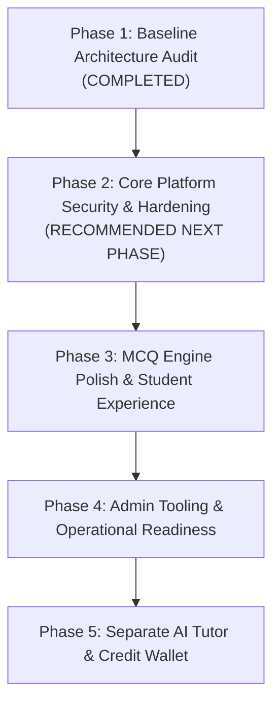

# TNPSC99 — Strategic Implementation Roadmap
**Document ID:** `TNPSC99-ROADMAP-001`  
**Assessment Date:** October 2026  
**Audited Repository:** `c:\Users\shanm\Downloads\project`  
**Core Strategy:** Student-First ₹99 MCQ Engine Hardening $\rightarrow$ Operational Maturity $\rightarrow$ Separate AI Tutor

---

## 1. Guiding Strategic Principles

1. **Protect the ₹99 MCQ Core:**  
   The ₹99/month unlimited MCQ practice test engine with verified textbook citations is the core value proposition and primary revenue driver. It must be blisteringly fast, 100% reliable, responsive on mobile, and incur zero ongoing third-party AI costs.
2. **Strict Zero-AI Cost Isolation:**  
   No feature within the standard ₹99 subscription (Practice, Exam, Performance Dashboard, Weak-Area Identification) may incur external LLM API fees. All analytical insights must be generated deterministically on client/server.
3. **Separate Metered AI Tutor:**  
   The Genkit AI Tutor ("Ask Your Doubt") must be architected as an optional add-on powered by an explicit AI Credit Wallet (microtransactions). Under no circumstances will standard subscribers receive unmetered LLM access.
4. **Zero-Trust Security & Data Integrity:**  
   No client will be trusted to self-report subscription status, admin privileges, or payment completions. All sensitive transitions will be validated server-side and enforced via strict Firestore security rules.

---

## 2. Multi-Phase Roadmap Overview



| Phase | Title | Core Focus | Target Duration | AI Cost Exposure |
| :---: | :--- | :--- | :---: | :---: |
| **Phase 1** | Baseline Architecture & Security Audit | Comprehensive code inspection, vulnerability detection, and roadmap specification. | *Completed* | **$0.00** |
| **Phase 2** | Core Platform Security & Hardening | Security rules lockdown, Razorpay webhook & verification, access gate fix, unlocking student PDF references, removing AI leak. | **Sprint 1 (Priority)** | **$0.00** |
| **Phase 3** | MCQ Engine Polish & Student Experience | Practice vs Exam mode split, revision vault, deterministic weak-area engine, full mock tests. | Sprint 2 | **$0.00** |
| **Phase 4** | Admin Tooling & Operational Readiness | Revenue tracking, bulk content operations, error monitoring, mobile performance optimization. | Sprint 3 | **$0.00** |
| **Phase 5** | Separate AI Tutor & Credit Wallet | AI credit recharge wallet, ledger transactions, RAG grounding on Samacheer textbooks, Genkit cost caps. | Sprint 4 | Isolated to prepaid wallet credits |

---

## 3. Phase-by-Phase Detailed Specifications

### Phase 1: Baseline Architecture Audit (COMPLETED)
- Conducted deep read-only inspection of repository structure, Next.js routes, Firebase config, rules, and payment integration.
- Cataloged 19 vision modules into COMPLETE, PARTIAL, MISSING, and BLOCKED statuses.
- Identified 7 critical security vulnerabilities and operational blockers.
- Produced baseline audit, completion matrix, security review, and roadmap.

---

### Phase 2: Core Platform Security & Hardening (RECOMMENDED NEXT PHASE)
**Objective:** Secure all revenue, user data, and cloud assets, while unlocking core student textbook references.

- **Task 2.1 — Firestore Security Rules Lockdown:**
  - Prevent user self-privilege escalation (prevent writing `isAdmin`, `role`, `subscriptionStatus`, `subscriptionExpires`).
  - Restrict test creation to validated user IDs.
  - Require authentication for reading question banks.
- **Task 2.2 — Firebase Storage Rules Hardening:**
  - Close completely open public read/write permissions.
  - Restrict textbook PDF upload and deletion strictly to Admins.
  - Grant read permissions only to authenticated users.
- **Task 2.3 — Server-Side Payment Verification & Razorpay Webhook:**
  - Enforce Firebase Auth Bearer token verification in `/api/razorpay/verify`.
  - Implement `/payments/{paymentId}` Firestore records for idempotency and replay protection.
  - Create `/api/razorpay/webhook` with signature validation to catch abandoned client checkouts.
- **Task 2.4 — Fix Subscription Gating Loophole:**
  - Correct the test route gate in `src/app/(app)/test/[slug]/page.tsx` so unpaying free users cannot access paid tests.
  - Define clear free demo tests (e.g., `demo-tamil-10-iel-1`).
- **Task 2.5 — Unlock Textbook Reference Viewer for Students:**
  - Remove `{userProfile?.isAdmin && ...}` condition from `mcq-test.tsx`.
  - Allow subscribed students (`isPremium || isAdmin`) to open the textbook reference PDF viewer.
  - Verify page offset calculations to ensure clicking the button lands on the exact printed textbook page.
- **Task 2.6 — Eliminate Unmetered AI LLM Leak in Performance Dashboard:**
  - Remove automatic Genkit LLM call on dashboard load.
  - Replace with a 100% deterministic, zero-cost TypeScript calculation for subject scores and topic accuracy.

---

### Phase 3: MCQ Test Engine Polish & Student Experience
**Objective:** Turn the test engine into a best-in-class preparation tool matching actual TNPSC exam standards.

- **Task 3.1 — Practice Mode vs Exam Mode Architecture:**
  - Introduce an explicit toggle before starting any test:
    - **Practice Mode:** Instant feedback on option select, immediate explanation display, immediate "View Textbook Reference" button, no countdown pressure.
    - **Exam Mode:** Continuous countdown timer, no answers revealed during test, OMR-style navigation grid, "Mark for Review" flag, full review screen after submission.
- **Task 3.2 — Deterministic Weak-Area Identification Engine:**
  - Aggregate past test answers by topic/chapter.
  - Automatically identify topics where accuracy is $< 65\%$.
  - Render a dedicated "Weak Topics" section on dashboard with a direct "Revise Weak Topics" button.
- **Task 3.3 — Student Revision Queue ("Mistake Vault"):**
  - Save all incorrectly answered question IDs to `/users/{uid}/mistakes/{questionId}`.
  - Provide a one-click "Practice My Mistakes" test generator that quizzes the student only on questions they previously got wrong.
- **Task 3.4 — Full-Length TNPSC Mock Tests:**
  - Create dedicated mock test engine supporting 100/200 questions across multiple subjects.
  - Implement periodic auto-saving of answers to localStorage and Firestore to survive accidental browser closure.

---

### Phase 4: Operational Readiness & Admin Tooling
**Objective:** Equip administrators with tools to manage large question banks, monitor subscriptions, and scale smoothly.

- **Task 4.1 — Financial & Subscription Administration:**
  - Admin dashboard view of total active subscribers, expiring subscriptions, and Razorpay transaction history.
  - Manual subscription management (extend validity by $X$ days, manual grant for offline payments).
- **Task 4.2 — Content Management & Quality Assurance:**
  - Bulk question management (delete/update entire chapter).
  - Built-in verification check verifying all questions have valid textbook PDF references and working page offsets.
- **Task 4.3 — Responsive Mobile UI Refinement:**
  - Implement a mobile-first slide-up drawer for the PDF reference viewer so students on smartphones can read the textbook passage without losing their question place.
- **Task 4.4 — Operational Logging & Error Monitoring:**
  - Implement structured server logging and error capture for API routes.

---

### Phase 5: Separate AI Tutor & Wallet System
**Objective:** Launch the AI Tutor as an optional premium add-on without impacting the core ₹99 pricing.

- **Task 5.1 — AI Credit Wallet Schema & Transactions:**
  - Introduce `aiCredits: number` on `/users/{uid}`.
  - Log every credit credit/debit in `/users/{uid}/credit_ledger`.
- **Task 5.2 — AI Credit Recharge Packs:**
  - Razorpay microtransaction checkout for credits (e.g., ₹29 for 50 credits, ₹49 for 100 credits).
- **Task 5.3 — Grounded AI Tutor ("Ask Your Doubt"):**
  - Implement conversational UI in `src/app/(app)/ask-your-doubt/page.tsx`.
  - Genkit flow strictly grounded with RAG on official Tamil Nadu Samacheer Kalvi textbooks.
  - Guardrail prompts to reject non-TNPSC topics.
  - Atomic Firestore transaction: 1 question answered = 1 credit deducted.
  - Hard stop when credit balance reaches 0.

---

## 4. Implementation Priority Matrix

```
┌──────────────────────────────────────────────────────────────────────────────┐
│ PRIORITY ORDER FOR IMMEDIATE IMPLEMENTATION                                  │
├──────┬───────────────────────────────────────────┬───────────────┬───────────┤
│ Rank │ Task                                      │ Phase         │ Urgency   │
├──────┼───────────────────────────────────────────┼───────────────┼───────────┤
│ 1    │ Fix Firestore & Storage Security Rules    │ Phase 2 (2.1) │ IMMEDIATE │
│ 2    │ Secure Razorpay Verification & Webhooks   │ Phase 2 (2.2) │ IMMEDIATE │
│ 3    │ Fix Subscription Gating Loophole          │ Phase 2 (2.3) │ IMMEDIATE │
│ 4    │ Unlock Student PDF Reference Viewer       │ Phase 2 (2.4) │ IMMEDIATE │
│ 5    │ Replace AI Dashboard Call with Local Math │ Phase 2 (2.5) │ IMMEDIATE │
│ 6    │ Implement Practice vs Exam Mode Toggle    │ Phase 3 (3.1) │ HIGH      │
│ 7    │ Build Deterministic Weak-Area Engine      │ Phase 3 (3.2) │ HIGH      │
│ 8    │ Build Revision Queue ("Mistake Vault")    │ Phase 3 (3.3) │ MEDIUM    │
│ 9    │ Full-Length Mock Test Engine              │ Phase 3 (3.4) │ MEDIUM    │
│ 10   │ AI Tutor & Credit Wallet                  │ Phase 5 (5.1) │ FUTURE    │
└──────┴───────────────────────────────────────────┴───────────────┴───────────┘
```
