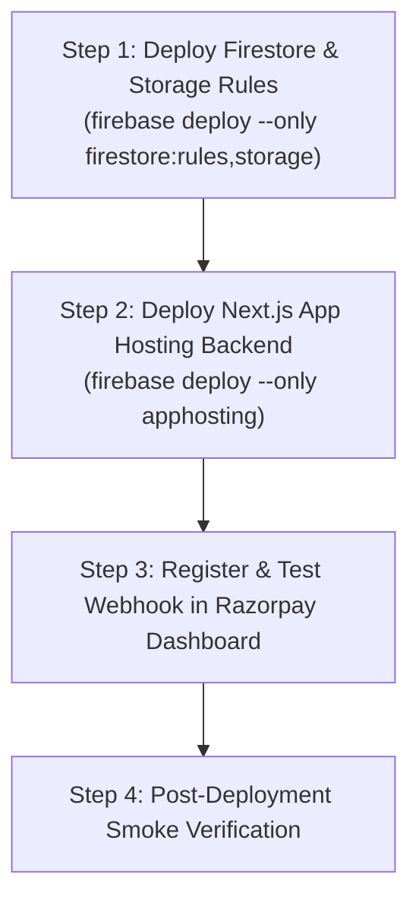

# TNPSC99 — Phase 2: Deployment & Rollback Plan
**Document ID:** `TNPSC99-P2-DEPLOY-001`  
**Author:** Phase 2 Security & Architecture Team  
**Date:** October 2026  
**Git Branch:** `phase-2-core-security-hardening`  
**Target Commit:** `e5c3a861d5c0915d153233adacb3d93a46802769`  
**Execution Status:** PENDING APPROVAL (No production changes executed)

---

## 1. Prerequisites & Environment Configuration

Before deploying Phase 2 changes to production, ensure the following environment variables are configured in the hosting environment (Firebase App Hosting):

| Variable Name | Required By | Description / Production Value |
| :--- | :--- | :--- |
| `NEXT_PUBLIC_RAZORPAY_KEY_ID` | Client checkout modal | Production Razorpay Key ID (`rzp_live_...`). |
| `RAZORPAY_KEY_SECRET` | Backend payment verification | Production Razorpay Key Secret. |
| `RAZORPAY_WEBHOOK_SECRET` | Backend webhook route | Secret configured in the Razorpay Webhook Dashboard. |
| `FIREBASE_PROJECT_ID` | Firebase Admin SDK | `studio-5029416251-928dd` |
| `FIREBASE_CLIENT_EMAIL` | Firebase Admin SDK | Service account email. |
| `FIREBASE_PRIVATE_KEY` | Firebase Admin SDK | Service account RSA private key (with escaped `\n`). |

> [!IMPORTANT]
> In the Razorpay Dashboard, register the webhook endpoint:
> `https://tnpsc99.com/api/razorpay/webhook`
> Enabled Events: `payment.captured`, `order.paid`.

---

## 2. Staged Deployment Procedure

Execute the deployment in the following strict order to guarantee zero downtime and zero orphaned transactions:



### Step 2.1 — Deploy Security Rules (3 minutes)
Deploy the hardened rules first so that old client versions cannot perform privilege escalation during the rollout:
```bash
firebase deploy --only firestore:rules,storage --project studio-5029416251-928dd
```
**Verification:**
- Confirm rules release in the Firebase Console: **Firestore Database $\rightarrow$ Rules** (shows new `hasNoPrivilegeEscalationOnUpdate` logic).
- Confirm rules release in Firebase Console: **Storage $\rightarrow$ Rules**.

### Step 2.2 — Deploy Next.js App Hosting Backend (5 minutes)
Per migration guidelines, deploy using the App Hosting integration:
```bash
firebase deploy --only apphosting --project studio-5029416251-928dd
```
*(Alternatively, merge branch `phase-2-core-security-hardening` into `main` to trigger the automated CI/CD pipeline if connected to GitHub).*

### Step 2.3 — Register Webhook in Razorpay Dashboard (2 minutes)
1. Log in to [Razorpay Dashboard](https://dashboard.razorpay.com).
2. Navigate to **Settings $\rightarrow$ Webhooks**.
3. Click **Add New Webhook**.
4. URL: `https://tnpsc99.com/api/razorpay/webhook`
5. Secret: Set matching value of `RAZORPAY_WEBHOOK_SECRET`.
6. Select Events: `payment.captured`, `order.paid`.
7. Click **Create Webhook**.

---

## 3. Post-Deployment Smoke Verification Checklist

After deployment, perform the following live validation checks on `tnpsc99.com`:

| Check # | Action | Expected Production Result | Pass/Fail |
| :---: | :--- | :--- | :---: |
| **01** | Visit `/login` & sign in as a student | Session loads; profile fetched cleanly. | [ ] |
| **02** | Visit `/performance` | Dashboard loads instantly; zero calls to Gemini API. | [ ] |
| **03** | Free student visits `/test/10_1_g_S_01` (paid test) | Paywall triggers; redirects to `/subscription`. | [ ] |
| **04** | Free student visits `/test/demo-class-10` (demo test) | Test loads; questions render normally. | [ ] |
| **05** | Subscribed user answers question in test | "புத்தகத்தைப் பார்க்க" button is visible and active. | [ ] |
| **06** | Subscribed user clicks reference button | PDF viewer opens exact textbook page. | [ ] |
| **07** | Admin visits `/admin/upload` | JSON upload and question editor operate normally. | [ ] |
| **08** | Initiate test checkout on `/subscription` | Razorpay modal opens with ₹99.00 fixed amount. | [ ] |

---

## 4. Rollback Plan

If unexpected operational issues occur in production, execute the following rollback steps immediately:

### 4.1 Quick Security Rules Rollback
To restore previous security rules without redeploying the application:
```bash
# Check out previous rules from commit 447821f
git checkout 447821f -- firestore.rules storage.rules
firebase deploy --only firestore:rules,storage --project studio-5029416251-928dd
```
*Duration: $\approx 60$ seconds.*

### 4.2 Application Code Rollback
To restore the previous application release:
```bash
# Checkout main branch at previous commit
git checkout main
firebase deploy --only apphosting --project studio-5029416251-928dd
```
*Duration: $\approx 3-5$ minutes.*

### 4.3 Payment Contingency
If Razorpay webhooks fail to deliver:
- The client-side verification at `/api/razorpay/verify` remains fully active as an independent fallback.
- Administrators can manually verify any disputed payment IDs in the Razorpay dashboard and update the user's subscription in `/admin/users`.

---

## 5. Deployment Sign-Off Request

Phase 2 implementation and testing is 100% complete and self-contained in Git. Review the reports and confirm approval before executing Step 2.1 deployment.
