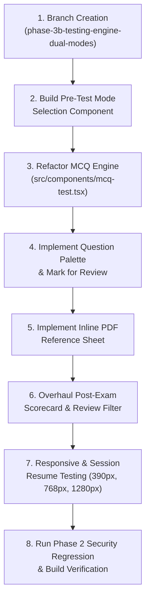

# TNPSC99 – Phase 3B: Testing Engine, Dual Modes & Student Experience Architecture Plan

**Document Reference:** `TNPSC99-PHASE3B-PLAN-v1.0`  
**Target Environment:** Local Workspace / Git Branch `phase-3b-testing-engine-dual-modes` (To be created upon authorization)  
**Execution Status:** **PLANNING ONLY — AWAITING EXPLICIT USER AUTHORIZATION**

---

## 1. Executive Summary & Objectives

Phase 3B transforms the core student testing experience of TNPSC99 from a single unified test screen into a dual-mode testing engine:

1. **Practice Mode (பயிற்சி முறை):** Immediate answer validation, inline rationale, instant textbook page references, and stress-free self-paced learning.
2. **Exam Mode (தேர்வு முறை):** Full TNPSC examination simulation, strict countdown timer, question palette navigation, mark-for-review support, zero answer revelation during the test, auto-submission on timer expiry, and an in-depth post-exam review suite.

All existing Firestore data structures, student historical attempts, question IDs, and Phase 2 security protections will be preserved with strict backward and forward schema compatibility.

---

## 2. Current Baseline vs. Phase 3B Architecture

| Component | Existing Implementation (`src/components/mcq-test.tsx`) | Phase 3B Architecture |
|---|---|---|
| **Mode Selection** | None. Single mode with hardcoded timer. | **Pre-Test Modal/Screen** allowing student to explicitly choose Practice Mode vs. Exam Mode. |
| **Answer Feedback** | Immediately locks radio button, turns green/red, and forces explanation open on click. | **Separated Behavior:**<br>• *Practice Mode:* Instant feedback & explanation reveal.<br>• *Exam Mode:* Option selected/changeable, zero correctness revealed until final submit. |
| **Question Navigation** | Linear Next/Previous buttons only. | **Question Palette:** Grid of numbered buttons with live status badges (Answered, Unanswered, Marked for Review). |
| **Mark for Review** | None. (Only bookmark to global user profile). | **In-Test Flag:** Toggle "Mark for Review" flag to highlight questions in palette for pre-submission checks. |
| **Timer Behavior** | Hardcoded per-question timer that continues even if user is learning. | • *Practice Mode:* Stopwatch or optional timer.<br>• *Exam Mode:* Strict countdown with auto-submit on 0:00 and unattempted count warnings. |
| **PDF Reference View** | Leaves the test screen via `router.push('/pdf-viewer')`, navigating away from test. | **Inline Reference Drawer / Sheet:** Opens textbook citation in a slide-over modal without unmounting the test session. |
| **Post-Exam Review** | Simple vertical list of questions below score. | **Dedicated Scorecard & Review Suite:** Accuracy rate, time analysis, filterable question review (Incorrect, Correct, Marked, All). |

---

## 3. Detailed Phase 3B Technical Specifications

### 3.1 Pre-Test Mode Selection Dialog
- **Trigger:** When navigating to `/test/[slug]`, before test questions are active.
- **UI:** A clean, accessible Radix Dialog (`ModeSelectDialog`):
  - **Option A: Practice Mode (பயிற்சி முறை)**
    - Icon: `CheckCircle2` (Emerald)
    - Subtitle: "Learn at your own pace with instant answer reveals and textbook references."
    - Features: Immediate answer validation, no time limit, instant explanations, bookmarking.
  - **Option B: Exam Mode (தேர்வு முறை)**
    - Icon: `Timer` (Indigo)
    - Subtitle: "Simulate official TNPSC examination hall conditions."
    - Features: Strict countdown timer, question palette, mark for review, answers revealed only upon final submission.
- **Persistence:** If resuming an in-progress session, the mode is read from `inProgressAttempt.mode` automatically, skipping the prompt.

### 3.2 State Management & Dual Feedback Engine
In `src/components/mcq-test.tsx`, state will be cleanly bifurcated:

```typescript
export type TestMode = 'practice' | 'exam';

export interface TestState {
  mode: TestMode;
  currentQuestionIndex: number;
  answers: (number | undefined)[];
  markedForReview: boolean[]; // Array matching questions.length
  timeRemainingSeconds: number;
  isSubmitted: boolean;
  score: number;
  viewingInlinePdf: { url: string; page: number; offset: number } | null;
}
```

- **In Practice Mode:**
  - Selecting an option immediately sets `isAnswered = true` for that question.
  - Displays instant Green / Red option feedback.
  - Automatically unfolds textbook citation and rationale accordion.
- **In Exam Mode:**
  - Selecting an option updates `answers[currentIndex]` without locking.
  - Student can freely change option A, B, C, D at any time before submission.
  - Zero color feedback (no green/red).
  - Explanations and textbook citations are strictly suppressed.
  - A prominent "Mark for Review" checkbox/button toggles `markedForReview[currentIndex]`.

### 3.3 Question Palette Component (`src/components/test/question-palette.tsx`)
- **Desktop Layout:** Right-hand sticky sidebar (width: 320px) showing:
  - Timer header with pause/save controls.
  - Status Summary Bar:
    - 🟩 Answered: `count`
    - ⬜ Unanswered: `count`
    - 🟪 Marked for Review: `count`
    - 🟪+🟩 Answered & Marked: `count`
  - Numbered Grid: 1 to N question pills.
  - One-click jump: clicking any question pill jumps directly to that question.
- **Mobile Layout (390px):**
  - Collapsible Sheet or bottom drawer triggered by a persistent bottom-bar icon.
  - Quick progress indicator: `Question X of Y (Z Answered)`.

### 3.4 Strict Exam Countdown & Auto-Submission
- **Timer Engine:** High-precision interval hook accounting for tab visibility changes.
- **Urgent Warning State:** When remaining time falls below 5 minutes (or 60 seconds for short tests), timer turns destructive red with a pulse animation.
- **Auto-Submission:** On `timeRemainingSeconds === 0`, immediately invokes `handleFinalSubmit(true)` (auto-submit flag), disables inputs, saves completed attempt to Firestore, and presents the scorecard.
- **Manual Submission Modal:**
  - Shows clear confirmation:
    - Total Questions: X
    - Answered: Y
    - Unanswered: Z
    - Marked for Review: W
  - "Are you sure you want to submit your examination?"

### 3.5 Inline Textbook PDF Drawer / Modal
- **Current Bug in Baseline:** Clicking "View Reference" calls `router.push('/pdf-viewer?url=...')`, causing a full page navigation away from `/test/[slug]`, risking session state loss.
- **Phase 3B Solution:**
  - Implement `<TextbookReferenceSheet />` using Radix Dialog / Sheet.
  - Embedded PDF viewer loads directly inside the sheet pointing to the verified page number (`page + offset`).
  - Student can review the exact textbook definition and immediately close the sheet without unmounting the test or reloading Firestore state.
  - Fully accessible in Practice Mode and during Post-Exam Review in Exam Mode.

### 3.6 Post-Exam Results & Deep Review Suite
Upon submission, renders a rich result dashboard:
1. **Performance Summary Card:**
   - Score: `X / Total` (Percentage %)
   - Time Taken: `Minutes and Seconds`
   - Accuracy: `% of attempted questions correct`
2. **Review Filter Tabs:**
   - **All Questions**
   - **Incorrect Answers Only** (high-yield revision)
   - **Unanswered Only**
   - **Marked for Review**
3. **Question Review Cards:**
   - Marked option with clear visual distinction (Green border for correct, Red for selected incorrect).
   - Official explanation with supporting textbook passage citations.
   - Button to open inline textbook reference sheet.

### 3.7 Database Schema & Compatibility

All Firestore changes are strictly additive:

```typescript
// users/{userId}/testAttempts/{attemptId}
export interface UserTestAttempt {
  // Existing Fields (PRESERVED 100%)
  id: string;
  userId: string;
  testId: string;
  testTitle: string;
  status: 'in-progress' | 'completed';
  currentQuestionIndex: number;
  answers: number[];
  questionIds: string[];
  score: number;
  isMockTest?: boolean;
  examGroup?: string;
  createdAt?: string;
  completedAt?: string;
  correctlyAnsweredQuestionIds?: string[];
  incorrectlyAnsweredQuestionIds?: string[];
  lastUpdatedDate?: string;

  // New Phase 3B Additive Fields
  mode?: 'practice' | 'exam';           // Defaults to 'practice' for legacy records
  timeRemainingSeconds?: number;
  markedForReviewIds?: string[];        // Array of question IDs flagged during test
  totalTimeSpentSeconds?: number;
}
```

- **Backward Compatibility:** All existing student attempts created in Phase 1 and Phase 2 will load seamlessly; if `mode` is missing, it safely falls back to `'practice'`.
- **Question IDs:** Every single existing question ID (`10_1_g_S_01` to `10_1_g_S_50` and all seed tests) is 100% preserved.

---

## 4. Phase 3B Step-by-Step Execution Sequence



---

## 5. Non-Negotiable Operational Constraints

1. **Zero MCQ Content Alterations:** MCQ corrections remain strictly paused. No question options, keys, or explanation texts will be modified.
2. **Zero Live Cloud Mutations:** No Firestore production database modifications, no live security rules publication, and no Firebase App Hosting deployments.
3. **Zero Financial Charges:** No real payment gateway charges; Razorpay signature tests use local cryptographic mocks.
4. **Zero Paid AI Inference:** AI Tutor remains strictly mocked or paused. No Genkit API calls to paid Gemini models.
5. **Clean Git Branching:** All Phase 3B work will occur in `phase-3b-testing-engine-dual-modes` branched from Phase 3A HEAD (`f345447`).
