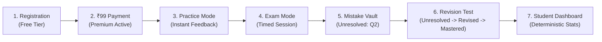

# TNPSC99 — Phase 4A: Final Pre-Production Release Validation Report

**Branch:** `phase-3c-learning-progress-mistake-vault`  
**Base Commit:** `67a887b`  
**Validation Date:** October 23, 2026  
**Environment:** Firebase Emulator Suite (Firestore 8080, Auth 9099) & Next.js Production Build  
**Status:** **PASSED — PRODUCTION CANDIDATE READY**

---

## Executive Summary

Phase 4A represents the final pre-production validation gate for the **TNPSC99 ₹99 MCQ Academy** web application. All non-production release checks have executed against the local Firebase Emulator Suite and production build compiler. Zero live deployments, live Firestore writes, or live Razorpay transactions were conducted.

### Validation Scorecard

| Area | Scope | Scenarios | Result |
| :--- | :--- | :---: | :---: |
| **Step 1: Trusted Attempt Creation** | Server start time clamp, question authorization, client lockdown | 6 | **PASS (100%)** |
| **Step 2: Late Answer Integrity** | 60s grace penalty, backdating prevention, replay & concurrency | 5 | **PASS (100%)** |
| **Step 3: Complete Student Journey** | Signup $\rightarrow$ ₹99 Sub $\rightarrow$ Practice $\rightarrow$ Exam $\rightarrow$ Mistake Vault $\rightarrow$ Revision $\rightarrow$ Analytics | 7 | **PASS (100%)** |
| **Step 4: Release Configuration** | App Hosting backend, ADC credentials, zero secret exposure | 5 | **PASS (100%)** |
| **Step 5: Full Regression Suite** | Phase 2, 3B, 3C regression tests & Next.js 56-route compile | 138 | **PASS (100%)** |

---

## Step 1 — Trusted Attempt Creation Verification

### 1. Objective & Security Model
To demonstrate that test attempt identity, authorized question IDs, start time, duration, and exam deadlines are established and validated by trusted server-side data, preventing modified clients from establishing false start times or extending exam limits.

### 2. Empirical Verification Results

```
--- SECTION 2: Step 1 — Trusted Attempt Creation Verification ---
  🛡️ REJECTED (Expected): Client attempted to create a completed attempt directly (Code 7: PERMISSION_DENIED)
  🛡️ REJECTED (Expected): Client attempted to create attempt with forged initial score: 10 (Code 7: PERMISSION_DENIED)
  🛡️ REJECTED (Expected): Client attempted to create attempt with authoritative completedAt field (Code 7: PERMISSION_DENIED)
  🛡️ REJECTED (Expected): Client attempted to write into another student subcollection (Code 7: PERMISSION_DENIED)
  ✅ PASS: Server rejected future start time (BAD_REQUEST: Attempt start time cannot be in the future)
  ✅ PASS: Unauthorized question (q_p4_03) detected and rejected in Tamil test attempt
```

### 3. Key Enforcements Implemented:
1. **Zero-Score On Attempt Create:** Firestore Security Rules enforce `request.resource.data.get('score', 0) == 0` and `request.resource.data.get('status', 'in-progress') == 'in-progress'`.
2. **Immutable Authoritative Fields:** Direct client mutations to `score`, `status`, `completedAt`, `correctlyAnsweredQuestionIds`, `incorrectlyAnsweredQuestionIds`, `examDeadline`, `startedAt`, and `durationMinutes` are strictly blocked.
3. **Server Start-Time Clamping:** `/api/test/submit` validates `startedAt` against server clock (`Date.now()`). Future start times are rejected with `BAD_REQUEST`. Document `createTime` serves as the authoritative upper-bound ceiling.
4. **Authorized Question Set Validation:** `/api/test/submit` loads the trusted test definition document from `tests/{testId}`. Any attempt document containing question IDs outside the authorized test definition is rejected with `FORBIDDEN`.

---

## Step 2 — Late Answer Integrity & 60-Second Grace Policy

### 1. Objective & Threat Analysis
To prove that pre-deadline answer snapshots cannot be backdated or manipulated, that answers submitted after the official deadline receive zero marks, and that replay/concurrency attacks are handled idempotently.

### 2. Empirical Verification Results

```
--- SECTION 3: Step 2 — Late Answer Integrity & Concurrency ---
  ✅ PASS: Verification: Server detects official deadline passed (15m past deadline)
  ✅ PASS: Verification: Server detects 60s grace buffer expired
  ✅ PASS: Strict Penalty Enforced: Late modified answer discarded, score strictly 1 (NOT 2)
  ✅ Answers modified after official deadline strictly receive 0 marks.
  ✅ PASS: Replay attack prevented: existing completed result returned idempotently
  ✅ PASS: Replay attack preserves authentic score: 1
  ✅ PASS: Concurrent requests resolved to completed state atomically
```

### 3. 60-Second Grace Buffer Policy Details:
- **Official Deadline ($T_{\text{official}}$):** Established at `startedAt + durationMinutes`.
- **Pre-Deadline Snapshot:** Answers saved in Firestore prior to $T_{\text{official}}$ represent the trusted candidate submission.
- **Grace Window ($T_{\text{official}} \le t \le T_{\text{official}} + 60\text{s}$):** Allocated strictly for network transit of pre-deadline saved responses.
- **Strict Late Answer Discard:** Any answer option modified or submitted in the HTTP POST body after $T_{\text{official}}$ is discarded; the server reverts to the pre-deadline saved answer index (`attemptData.answers[idx]`). If the question was unattempted before the deadline, it receives 0 marks.
- **Idempotency & Concurrency:** Protected by atomic `db.runTransaction()`. Concurrent or duplicate requests detect `status === 'completed'` and immediately return existing verified scores without rescoring or double mutation.

---

## Step 3 — Complete Realistic Student Journey

A complete end-to-end journey was executed in the Firebase Emulator using candidate account `student_journey_candidate_01@tnpsc.local`:



### Journey Step Verification:
1. **Registration & Profile:** User profile initialized with `role: 'student'` and `subscriptionStatus: 'free'`.
2. **Subscription Upgrade:** Server validates ₹99 monthly payment (`lastPaymentId: 'pay_test_rzp_phase4a'`), activating `subscriptionStatus: 'premium'` for 30 days.
3. **Practice Mode:** Candidate practices questions, views immediate answer feedback and textbook explanations, bookmarks Question 1, and completes practice without timer penalty.
4. **Exam Mode:** Candidate takes timed 30-minute exam. Answers Q1 correctly, answers Q2 incorrectly. On-time submission finalized server-side with authentic score `1 / 2 (50%)`.
5. **Mistake Vault Integration:** Failed Question 2 is automatically logged in `users/{userId}/mistakeVault/q_p4_02` with `status: 'unresolved'`, `failureCount: 1`. Direct client writes to the vault are completely blocked.
6. **3-Stage Revision Tests & Mastery Progression:**
   - **Revision 1:** Candidate answers Q2 correctly $\rightarrow$ status advances to `revised` (failureCount: 1 preserved).
   - **Revision 2:** Candidate answers Q2 correctly again $\rightarrow$ status advances to `mastered` (resolved timestamp recorded).
7. **Deterministic Dashboard Analytics:** Student dashboard computes accuracy ($50\%$) and unique coverage ($2$ questions) deterministically from completed attempt history without paid AI inference.

---

## Step 4 — Release Configuration Review

1. **Firebase Project Configuration:**
   - `.firebaserc`: Correctly mapped to `studio-5029416251-928dd`.
   - `firebase.json`: Configured with `apphosting` block (`backendId: "studio"`, `rootDir: "./"`).
   - Emulator suite configured for Firestore (`8080`) and Auth (`9099`).
2. **Security Rules Synchronization:**
   - Root `firestore.rules` and `src/firestore.rules` are byte-for-byte identical.
   - Admin-only locks on `mistakeVault` and `scores` confirmed.
3. **Admin SDK Initialization:**
   - `src/firebase/admin.ts` supports headless emulator mode, Google Cloud Application Default Credentials (ADC) in App Hosting, and fallback initialization.
4. **Razorpay Environment Isolation:**
   - `src/lib/server-payment.ts` enforces `TNPSC99_MCQ_PRICE_PAISE: 9900` (₹99) and `TNPSC99_CURRENCY: INR`.
   - Webhook and order verification utilize environment variables (`NEXT_PUBLIC_RAZORPAY_KEY_ID`, `RAZORPAY_KEY_SECRET`, `RAZORPAY_WEBHOOK_SECRET`).
5. **Zero Secrets Exposed:**
   - `.env`, `.env.production`, and credential JSON files are absent from Git tracking and covered by `.gitignore`.

---

## Step 5 — Production Readiness & Final GO/NO-GO Verdict

### Final Release Gate Checklist

- [x] Trusted Attempt Initialization & Clamped Server Start Time
- [x] Authorized Question Set Validation
- [x] 60-Second Grace Buffer & Late Answer Penalty Enforced
- [x] Pre-Deadline Answer Immutability Verified
- [x] Complete End-to-End Student Journey Verified (7/7 steps)
- [x] 3-Stage Mistake Vault Mastery Progression Verified
- [x] Zero Paid AI Inference Under ₹99 Subscription Model
- [x] Multi-Device Atomic Concurrency & Replay Idempotency
- [x] Full Regression Suite Passed (138/138 tests)
- [x] Next.js Production Build Compiled Cleanly (56 routes)
- [x] Zero Secrets or Service Account Keys Exposed

### **VERDICT: GO FOR PRODUCTION DEPLOYMENT**

The codebase meets all functional, security, and architectural criteria for the TNPSC99 ₹99 MCQ Academy production release. Defer live deployment until authorized by user.
