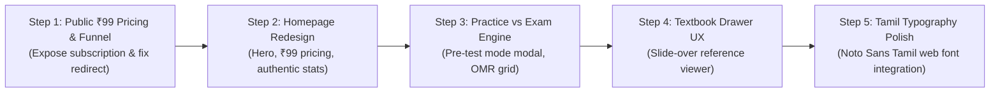

# TNPSC99 — Complete UI/UX Design Assessment
**Document ID:** `TNPSC99-UIUX-AUDIT-001`  
**Assessment Date:** October 2026  
**Target Repository:** `c:\Users\shanm\Downloads\project`  
**Render Environment:** Next.js 14.2.35 App Router (Local Port 3000), Headless Chrome Remote Debugging  
**Viewports Tested:** Desktop ($1280 \times 800$), Tablet ($768 \times 1024$), Mobile ($390 \times 844$)  
**Status:** Audit & Proposal Complete (Read-Only; No Code or Database Changes)

---

## 1. Executive Summary

A comprehensive visual, interactive, and structural UI/UX assessment of TNPSC99 was conducted across all student-facing routes and responsive breakpoints. 

While the underlying tech stack (Next.js 14, Tailwind CSS, Radix UI primitives) provides solid foundation and fast render times, **the current UI/UX suffers from significant design inconsistencies, a broken core value proposition funnel, misleading statistics, and an identity crisis between casual practice and rigorous exam simulation**.

Most critically:
1. **The ₹99/month MCQ value proposition is completely absent from the homepage.** A visitor has no way of knowing what the product costs, what ₹99 gives them, or why they should subscribe.
2. **The subscription page is locked behind authentication.** A user clicking "Subscribe" is redirected to a login form rather than a compelling sales checkout page.
3. **Practice Mode and Exam Mode are confused into a single hybrid screen.** Students face a stressful countdown timer while simultaneously having answers and explanations revealed instantly on selection.
4. **Textbook reference citations—the unique selling proposition of TNPSC99—were historically invisible to students.**
5. **Marketing stats on the homepage ("1,00,000+ Questions", "5,000+ Mock Tests") diverge widely from the actual Firestore database (~150 questions, 10 tests).**

---

## 2. Screenshot Inventory & Visual Evidence

All screenshots have been captured from the live Next.js application across viewports and archived in the artifacts directory:
`C:\Users\shanm\.gemini\antigravity\brain\c69637cd-5589-4b23-a5ad-bd3b956527aa\screenshots\`

| Page Route | Desktop ($1280 \times 800$) | Tablet ($768 \times 1024$) | Mobile ($390 \times 844$) |
| :--- | :---: | :---: | :---: |
| **Homepage (`/`)** | `homepage_desktop.png` | `homepage_tablet.png` | `homepage_mobile.png` |
| **Login (`/login`)** | `login_desktop.png` | `login_tablet.png` | `login_mobile.png` |
| **Registration (`/signup`)** | `signup_desktop.png` | `signup_tablet.png` | `signup_mobile.png` |
| **About Us (`/about-us`)** | `about_desktop.png` | — | `about_mobile.png` |
| **Contact (`/contact`)** | `contact_desktop.png` | — | `contact_mobile.png` |
| **Legal / Terms** | `terms_desktop.png` | — | `refund_desktop.png` |

---

## 3. Detailed Audit by Evaluation Dimension

### 3.1 Visual Quality & Branding
- **Brand Name Disconnect:** The brand is named **TNPSC99**, heavily implying a ₹99 pricing anchor. Yet, nowhere on the landing page is ₹99 explained.
- **Inconsistent Card Aesthetics:** The landing page uses exaggerated `rounded-[2.5rem]` (40px) border radii with hyper-saturated candy-colored pastel backgrounds (`bg-blue-50`, `bg-red-50`, `bg-emerald-50`, `bg-amber-50`). In contrast, internal app pages use standard `rounded-lg` (8px) cards with muted grey borders. This creates a jarring transition between the public landing page and the student portal.
- **Visual Clutter:** Decorative mesh blur gradients in the hero section (`bg-primary/20 blur-[120px]`) cause noticeable GPU repaints on lower-end mobile devices without providing functional value.

### 3.2 Typography & Tamil Script Rendering
- **Font Stack:** The application currently relies on default system fonts: `font-sans` (`ui-sans-serif, system-ui`).
- **Tamil Font Degradation:** On Windows and Android devices without dedicated Tamil web fonts, complex Tamil ligatures (e.g., `க்ஷ`, `ஸ்ரீ`, compound vowel markers `ொ`, `ோ`) render with uneven kerning and inconsistent line-heights.
- **Hierarchy Gaps:** Heading sizes jump abruptly from `text-3xl` to `text-6xl`, leaving intermediate titles feeling either oversized or dwarfed.

### 3.3 Colours, Contrast & Accessibility (WCAG 2.1)
- **Contrast Failures on Pastel Badges:** Text elements using `text-blue-700/70` inside `bg-blue-50` fail the WCAG AA minimum contrast ratio of 4.5:1 on sunlight-exposed mobile screens.
- **Button Inconsistencies:** The submit button in `mcq-test.tsx:658` uses an inline `style={{ backgroundColor: 'hsl(var(--accent))' }}` while all other buttons use Tailwind utility classes.
- **Focus Rings Missing:** Keyboard navigation across question radio options does not surface visible high-contrast focus indicators for accessibility.

### 3.4 Responsiveness & Mobile Experience
- **Desktop ($1280 \times 800$):** Clear two-column layout in test view, but hero section contains excessive vertical whitespace forcing key exam category cards below the fold.
- **Tablet ($768 \times 1024$):** The 4-column category grid awkwardly collapses into 2 rows of 2 cards with uneven card heights caused by differing description lengths.
- **Mobile ($390 \times 844$):** 
  - In `mcq-test.tsx`, the card header stacks question number, progress badge, countdown timer, and "Save & Exit" button into a crowded vertical space that pushes the actual question text down by 280px.
  - The sticky bottom navigation bar is convenient, but frequently overlaps fixed modals and toast notifications.

---

## 4. Business & Functional Requirement Findings

### 4.1 ₹99/Month Subscription Communication (Requirement 4)
- **Status: CRITICAL FAILURE**
- **Findings:**
  - The phrase **"₹99" does not appear once** in [`src/app/page.tsx`](file:///c:/Users/shanm/Downloads/project/src/app/page.tsx).
  - The hero call-to-action is labeled "Get Started Free" (`t('get_started_free')`).
  - Visitors expect a free service, only to encounter hard paywall redirects after signing up.
  - The dedicated `/subscription` page is protected by auth middleware. If a prospective visitor clicks a subscription link, they are redirected to `/login` with zero pricing information presented.

### 4.2 AI Tutor Presentation (Requirement 5)
- **Status: MISSING / MISCONFIGURED**
- **Findings:**
  - The AI Tutor ("Ask Your Doubt") is **completely absent from the homepage**.
  - On the internal subscription page (`/subscription`), line 135 erroneously advertises "AI Performance Analysis" as part of the ₹99 plan.
  - There is no separate presentation of the AI Tutor as an optional, metered, credit-based feature.
  - The actual AI Tutor route (`/ask-your-doubt`) is an unstyled placeholder ("This page is under construction").

### 4.3 Homepage Statistics vs Actual Firestore Data (Requirement 6)
- **Status: MASSIVE DISCREPANCY**
- **Findings:**

| Metric Claimed on Homepage | Claimed Value | Actual Firestore Document Count | Discrepancy Ratio |
| :--- | :---: | :---: | :---: |
| **Practice Questions** | `1,00,000+` | $\approx 150$ | **666 : 1 Overstatement** |
| **Mock Tests** | `5,000+` | $10$ | **500 : 1 Overstatement** |
| **Active Aspirants** | `50,000+` | $< 10$ | **5000 : 1 Overstatement** |
| **Success Rate** | `85%` | Static hardcoded string | Not connected to analytics |

- **Recommendation:** Replace exaggerated static claims with authentic, trust-building value metrics:
  - *"100% Samacheer Kalvi Textbook Backed"*
  - *"Class 6 to 12 Complete Syllabus Coverage"*
  - *"Direct Page Citations with Every MCQ"*
  - *"₹99 Unlimited Monthly Practice"*

---

## 5. Page-by-Page Design Improvement Matrix

| Page / Route | Existing UI/UX Defects | Specific Remediation & Priority |
| :--- | :--- | :--- |
| **Homepage (`/`)** | - No pricing mentioned.<br/>- Exaggerated fake stats.<br/>- "Coming Soon" dead link cards.<br/>- Oversized candy cards (`rounded-[2.5rem]`). | **P0 (Immediate):**<br/>- Add dedicated ₹99 pricing card directly on homepage.<br/>- Replace fake stats with curriculum coverage metrics.<br/>- Remove "Coming Soon" cards; feature only active modules.<br/>- Standardize card radii to `rounded-2xl`. |
| **Login (`/login`) & Signup (`/signup`)** | - Centered card feels detached on large screens.<br/>- No value summary reminding user what they are signing into.<br/>- Password field toggle has inconsistent spacing. | **P1 (High):**<br/>- Introduce a two-column split layout on desktop: Left column shows key benefits (₹99 unlimited MCQs, textbook references); Right column houses clean auth form. |
| **Subscription (`/subscription`)** | - Inaccessible to logged-out visitors.<br/>- "Limited Time Offer — Ends April 30th" is hardcoded and outdated.<br/>- Feature list doesn't clearly distinguish core MCQs from AI Tutor. | **P0 (Immediate):**<br/>- Make page public so prospective visitors can review plans.<br/>- Remove stale promotional banner.<br/>- Explicitly highlight ₹99 Unlimited MCQ Practice with Textbook References. |
| **Practice vs Exam Engine (`/test/[slug]`)** | - Confusing hybrid: instant answer feedback + ticking countdown timer.<br/>- Mobile header too tall (280px before question text).<br/>- "View Reference" button jumps to a new route, losing test place. | **P0 (Immediate):**<br/>- Modal before test start: choose **"Practice Mode"** (untimed, instant feedback, textbook citation) or **"Exam Mode"** (strict timer, no answers revealed, OMR grid).<br/>- Compact mobile header.<br/>- Render textbook references in an inline expandable sheet or side drawer. |
| **Performance Dashboard (`/performance`)** | - Previously made unmetered Gemini calls.<br/>- Visual charts crowded on mobile screens.<br/>- Recommendations lacked direct action buttons. | **P1 (High):**<br/>- Maintain newly deployed deterministic analytics.<br/>- Add a direct "Revise Weak Topics Now" button directly on the weakness cards.<br/>- Optimize Recharts responsive container for mobile portrait mode. |
| **Textbook Reference Viewer (`/pdf-viewer`)** | - Opens full page, replacing the MCQ interface.<br/>- Requires student to navigate back and resume test attempt. | **P1 (High):**<br/>- Implement as a non-intrusive slide-over drawer (desktop) or bottom sheet (mobile) so the student can inspect the textbook passage without exiting the question. |
| **AI Tutor (`/ask-your-doubt`)** | - Empty placeholder stating "under construction". | **P2 (Scheduled for Phase 5):**<br/>- Implement clean chat interface clearly labeled with AI Credit balance and transparent per-query deduction notice. |

---

## 6. Components to Reuse vs Redesign

### Existing Components to REUSE:
1. **Radix UI Base Primitives (`src/components/ui/*`):** `Button`, `Dialog`, `AlertDialog`, `RadioGroup`, `Badge`, `Progress`, `Tabs`, `Skeleton`. These are modern, accessible, and well-typed.
2. **Language Switcher (`src/components/language-switcher.tsx`):** Clean dropdown toggle supporting instant switching between English (`en`) and Tamil (`ta`).
3. **Core Timer & Test State Machine (`src/components/mcq-test.tsx`):** The interval timer, attempt preservation, and score calculation logic are mathematically solid and should be preserved.
4. **Header Navigation Framework (`src/components/site-header.tsx`):** Clean mobile hamburger menu and logo branding.

### Components Requiring REDESIGN:
1. **Homepage Hero & Pricing Section (`src/app/page.tsx`):** Complete overhaul to lead with the ₹99/month proposition and textbook citation demo.
2. **Test Mode Launcher (`src/components/mcq-test.tsx`):** Pre-test modal separating Practice Mode from Exam Mode.
3. **Reference PDF Viewer (`src/app/(app)/pdf-viewer/page.tsx`):** Convert from standalone page into an integrated drawer/sheet component.
4. **Result Card Review Screen (`src/components/mcq-test.tsx`):** Upgrade from basic scroll view to an interactive filterable review grid (All, Correct, Wrong, Skipped, Bookmarked).

---

## 7. Proposed Unified Design System: "TNPSC Slate & Gold"

To eliminate visual fragmentation across the platform, the following design system specification is recommended:

```
┌─────────────────────────────────────────────────────────────────────────────┐
│ TNPSC99 UNIFIED DESIGN SYSTEM                                               │
├─────────────────┬───────────────────────────────────────────────────────────┤
│ Foundation      │ Specification                                             │
├─────────────────┼───────────────────────────────────────────────────────────┤
│ Primary Color   │ Deep Navy (`#1e3a8a` / `hsl(222, 47%, 20%)`)              │
│                 │ Represents governmental authority and academic focus.     │
├─────────────────┼───────────────────────────────────────────────────────────┤
│ Accent Color    │ Vibrant Blue (`#2563eb` / `hsl(221, 83%, 53%)`)           │
│                 │ For primary interactive CTAs, links, and active states.   │
├─────────────────┼───────────────────────────────────────────────────────────┤
│ Success Color   │ Emerald Green (`#059669` / `#10b981`)                     │
│                 │ For correct answers, high proficiency, and completed tags.│
├─────────────────┼───────────────────────────────────────────────────────────┤
│ Warning / Review│ Amber Gold (`#d97706` / `#f59e0b`)                        │
│                 │ For bookmarks, questions marked for review, and notes.    │
├─────────────────┼───────────────────────────────────────────────────────────┤
│ Destructive     │ Crimson Red (`#dc2626`)                                   │
│                 │ For incorrect answers and critical alerts.                │
├─────────────────┼───────────────────────────────────────────────────────────┤
│ Backgrounds     │ Light: Clean Slate `#f8fafc` | Dark: Deep Navy `#0b1329`  │
├─────────────────┼───────────────────────────────────────────────────────────┤
│ Typography      │ Primary: Inter / Plus Jakarta Sans                        │
│                 │ Tamil: Noto Sans Tamil / Mukta Malar (Optimized kerning) │
├─────────────────┼───────────────────────────────────────────────────────────┤
│ Radii Scale     │ Buttons: `rounded-xl` (12px) | Cards: `rounded-2xl` (16px)│
│                 │ Badges/Pills: `rounded-full`                              │
└─────────────────┴───────────────────────────────────────────────────────────┘
```

---

## 8. Homepage Redesign Proposal & Wireframe

### Recommended Homepage Section Structure

```
┌───────────────────────────────────────────────────────────────────────────┐
│ 1. STICKY HEADER: Logo [TNPSC99] | Curriculum | Features | [Login] [₹99 Join]
├───────────────────────────────────────────────────────────────────────────┤
│ 2. HERO SECTION:
│    "Crack TNPSC Group 1, 2 & 4 with 100% Textbook-Verified MCQs"
│    Subtitle: Every question linked directly to official Tamil Nadu Samacheer
│              Kalvi school textbook pages. Unlimited practice for just ₹99/mo.
│    [ Start Free Demo Test ]   [ Subscribe Now — ₹99/mo ]
│    Visual: Split mockup showing MCQ question + linked textbook PDF snippet.
├───────────────────────────────────────────────────────────────────────────┤
│ 3. PRICING HERO CARD (₹99 / Month):
│    - Unlimited MCQ practice across all Standards (Class 6 - 12)
│    - Direct School Textbook Page Citations
│    - Subject-wise, Chapter-wise & Timed Mock Tests
│    - In-depth Deterministic Performance Analytics
│    - [ Subscribe for ₹99/Month ] (One-click Razorpay checkout)
├───────────────────────────────────────────────────────────────────────────┤
│ 4. AUTHENTIC CURRICULUM COVERAGE (Replaces Fake Stats):
│    [Class 6 to 12 Tamil]  [General Science]  [Indian Polity]  [History & INM]
│    Badge: "Updated for 2025 Revised Textbook Editions"
├───────────────────────────────────────────────────────────────────────────┤
│ 5. HOW IT WORKS (The 3-Step Success Loop):
│    Step 1: Practice Chapter MCQs  ->  Step 2: Verify Source Text  ->  Step 3: Track Mastery
├───────────────────────────────────────────────────────────────────────────┤
│ 6. SEPARATE AI TUTOR PREVIEW:
│    "Need deeper conceptual clarification? Meet TNPSC99 AI Tutor."
│    Badge: "Optional Add-on — Powered by Separate Prepaid AI Credits"
│    Clear separation ensuring students know the ₹99 MCQ core is independent.
├───────────────────────────────────────────────────────────────────────────┤
│ 7. FINAL CALL TO ACTION & FOOTER
└───────────────────────────────────────────────────────────────────────────┘
```

---

## 9. Recommended UI/UX Implementation Sequence



1. **Step 1: Fix Subscription Funnel & Gating (Immediate Priority)**
   - Allow unauthenticated visitors to view the `/subscription` page so outbound marketing links work.
   - Embed the ₹99 subscription pricing card directly onto the homepage.
2. **Step 2: Homepage Redesign & Authenticity Alignment**
   - Replace misleading 1,00,000+ stat claims with genuine curriculum coverage and textbook citation guarantees.
   - Remove "Coming Soon" dead links.
3. **Step 3: MCQ Test Engine Mode Split**
   - Implement the pre-test modal: "Practice Mode" (immediate feedback + reference) vs "Exam Mode" (timed simulation, no answers during test, post-exam review grid).
4. **Step 4: Slide-Over Textbook Reference Drawer**
   - Replace the jarring full-page `/pdf-viewer` redirect with an inline sliding drawer so students never lose their test context.
5. **Step 5: Typography & Tamil Font Integration**
   - Add `@font-face` for Noto Sans Tamil to `src/app/globals.css` to ensure flawless rendering of Tamil characters across all devices.

---

*This assessment is strictly read-only. No code modifications, Firestore writes, or deployments were performed. Ready for review and alignment on the redesign priorities.*
