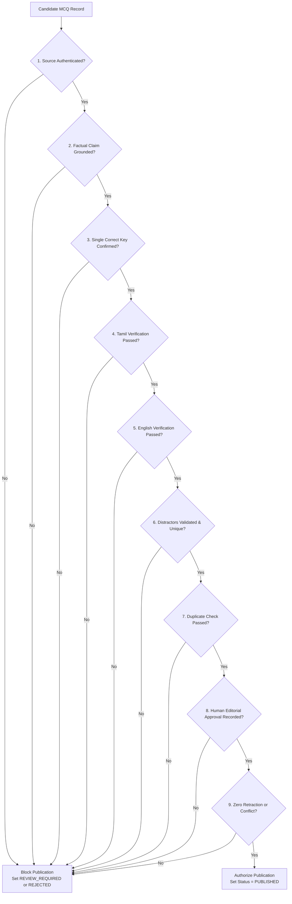
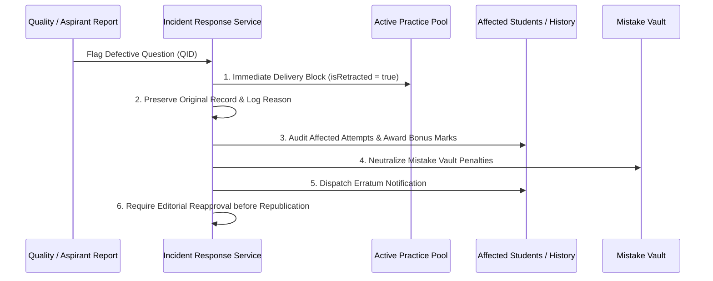

# TNPSC99 — Permanent Zero-Compromise MCQ Accuracy Policy

**Document Version:** 1.0.0  
**Effective Date:** 2026-10-24  
**Applies To:** All TNPSC99 Content (Textbook MCQs, Mock Tests, Public Sample Questions, Daily Current Affairs, AI Tutor Content)  
**Governance Standard:** Permanent Platform Quality & Editorial Integrity Mandate  

---

## 1. Highest Priority Mandate

> **The accuracy of every Multiple Choice Question (MCQ) is the primary product requirement of TNPSC99.com.**
> 
> Under no circumstances shall factual accuracy be compromised for:
> - Question volume or catalogue size
> - Daily or weekly publishing cadence / frequency
> - AI automation or unattended ingestion pipelines
> - Operational cost reduction or compute savings
> - Release deadlines or product launch milestones

In competitive Tamil Nadu civil services examinations (TNPSC Group I, Group II/IIA, and Group IV/VAO), a single contested mark alters civil service rank lists, service allocations, and life outcomes for aspirants. Every question published on TNPSC99.com must be indisputably defensible against official State and Central Government primary documents.

---

## 2. The 10 Mandatory Accuracy Rules

1. **Authentic Primary Evidence Prerequisite:**  
   No MCQ may enter the published question bank without authentic, accessible, and retrievable primary source evidence.
2. **Primary Source Grounding:**  
   Every factual claim and correct answer key must be independently verified against its original primary source (Tamil Nadu Government Gazettes, DIPR releases, Union Ministry documents, legislative enactments, or State Board textbooks).
3. **Rigorous Distractor Validation:**  
   Every incorrect option (distractor) must be explicitly verified as incorrect within the context of the question. Trivial, deceptive, or ambiguous distractors are forbidden.
4. **Bilingual Parity & Index Synchronization:**  
   Tamil and English statements must convey exactly the same meaning. The correct answer index must be identical in both language representations, and official Tamil Nadu Government terminology must be respected.
5. **Precise Textbook Citations:**  
   Textbook-based questions must provide exact citations to the Tamil Nadu State Board (Samacheer Kalvi) edition, subject, standard (Classes 6 to 10), term/volume, and printed page number.
6. **Zero-Tolerance for Hallucination & Fabrication:**  
   Fabricated URLs, synthetic landing pages, invented quotations, unsupported historical dates, and outdated statistical figures are strictly prohibited and trigger immediate question rejection.
7. **Independence from Model Assertions:**  
   Independent verification must not merely repeat or summarize the generating LLM's assertions; verification must execute adversarial checks directly against raw source text.
8. **Disallowance of AI Confidence as Publishing Authority:**  
   AI confidence scores, automated unit test success, and simple source-domain whitelist checks alone must never authorize publication.
9. **Mandatory Human Editorial Sign-Off:**  
   Every publication requires recorded human editorial approval (reviewer UID, timestamp, and review notes) until a separately certified, unattended publication policy is explicitly authorized by platform leadership.
10. **Immutable Provenance & Audit Trail:**  
    All questions must retain raw source evidence, question version history, reviewer identity, approval timestamps, and full lifecycle audit logs.

---

## 3. Fail-Closed Publication Gate

Before any candidate MCQ is transitioned to `PUBLISHED` status, it must satisfy all nine verification conditions simultaneously:

### The 9 Publishing Conditions

| # | Gate Condition | Verification Requirement | Failure Action |
| :-: | :--- | :--- | :--- |
| **1** | **Source Authenticated** | Valid canonical URL, recognized primary publisher, raw document excerpt $\ge 20$ characters. No generic domains or broken links. | Set `REJECTED` |
| **2** | **Factual Verification** | Sentence-level citation in source excerpt directly proving the correct answer key. | Set `REVIEW_REQUIRED` |
| **3** | **Single Correct Key** | Blind-solver simulation verifies that exactly one option is correct. No two options can be valid. | Set `REVIEW_REQUIRED` |
| **4** | **Tamil Verification** | Valid Tamil Unicode syntax, no untranslated English fragments, official terminology alignment. | Set `REVIEW_REQUIRED` |
| **5** | **English Verification** | Grammatically sound, unambiguous, professional academic English phrasing. | Set `REVIEW_REQUIRED` |
| **6** | **Distractor Verification** | 4 unique options; no "All of the above", "None of the above", or "Both A and B"; length balance within $4.5\times$ threshold. | Set `REVIEW_REQUIRED` |
| **7** | **Duplicate Check** | SHA-256 fingerprint check against existing question bank to prevent duplicate question stems. | Set `REJECTED` |
| **8** | **Human Editorial Sign-Off** | Valid admin reviewer UID, review timestamp, and approval signature recorded. | Set `REVIEW_REQUIRED` |
| **9** | **Conflict / Retraction Check** | `isRetracted !== true`, `isQuarantined !== true`, zero unresolved errata. | Set `REJECTED` |

**Rule:** If any condition fails, publication is blocked. The gate fail-closed mechanism never silently bypasses a failed check.

---

## 4. Existing Question Bank Audit & Non-Destructive Quarantine

The Zero-Compromise Accuracy standard applies equally to the existing question bank, historical test series, and public sample MCQs:

1. **Controlled Batch Audits:**
   - Existing questions are audited in deterministic batches against primary source records and textbook citations.
2. **Preservation of Student Records:**
   - Completed student test attempts, score histories, and subscription entitlements must never be deleted or silently altered during an audit.
3. **Non-Destructive Quarantine Procedure:**
   - Questions identified as defective or lacking authoritative source evidence are marked with:
     - `status: 'REVIEW_REQUIRED'` or `'REJECTED'`
     - `isQuarantined: true`
     - `quarantineReason`: e.g., `SOURCE_UNVERIFIED`, `FACT_CONFLICT`, `DATE_MISMATCH`
     - `quarantineNotes`: detailed explanation of the defect
   - Quarantined questions are immediately excluded from active practice pools without corrupting completed exam histories.
4. **Correction Plans:**
   - Bulk alteration of published questions or historical scoring requires a documented, separately reviewed correction plan.

---

## 5. Daily Current Affairs Policy

1. **Transparent Edition Sizing:**
   - Target daily quota is 10 questions.
   - If only 6 questions pass all 9 verification gates, publish **at most those 6 questions** and explicitly label the edition as a 6-question edition.
   - Never fabricate, generate, or lower verification standards to artificially satisfy a 10-question quota.
2. **Zero-Verified Fallback:**
   - If 0 questions achieve verified sign-off by the morning publishing window, the public interface must display:  
     `"Editorial Verification in Progress"` (`"ஆசிரியர் குழு சரிபார்ப்பு நிலையில் உள்ளது"`).
   - The platform strictly informs aspirants that verification against official Government Gazettes is underway rather than surfacing unapproved content.

---

## 6. Publication Incident Response Protocol

If an error, incorrect answer key, or source discrepancy is discovered in a published question:

1. **Immediate Delivery Blocking:**  
   Instantly set `status = 'RETRACTED'` and `isRetracted = true`. The question is immediately stripped from active test pools, daily feeds, and practice modules.
2. **Immutable Evidence Preservation:**  
   The original question text, options, previous key, correction reason, and timestamp are archived in `accuracy_audit_incident_logs`.
3. **Affected Candidate Audit:**  
   Query all `testAttempts` and `examHistory` records referencing the question ID.
4. **Standard TNPSC Erratum Protocol:**  
   In accordance with official TNPSC Commission erratum procedure, **full marks are awarded to all candidates** who attempted the defective question, recalculating total scores non-destructively.
5. **Mistake Vault Neutralization:**  
   Any penalty recorded in an aspirant's Mistake Vault (`users/{userId}/mistakeVault/{questionId}`) is neutralized so the erratum does not corrupt their concept mastery rating.
6. **Mandatory Human Reapproval:**  
   A retracted question can never be automatically restored. It requires fresh primary source evidence and manual human editorial sign-off before republication.

---

## 7. Platform Status Reporting Categories

The platform must maintain and report real-time, tamper-proof counts across seven mutually exclusive lifecycle categories:

1. **`DRAFT`:** Questions generated or drafted but not yet verified.
2. **`SOURCE_VERIFIED`:** Questions that passed automated source grounding and deterministic checks.
3. **`HUMAN_APPROVED`:** Questions reviewed and signed off by an authorized human editor.
4. **`PUBLISHED`:** Questions currently active in live public or premium practice pools.
5. **`REVIEW_REQUIRED`:** Candidate questions that failed one or more gate checks or were flagged for editorial re-inspection.
6. **`REJECTED`:** Questions failing factual, distractor, or licensing standards, permanently excluded.
7. **`RETRACTED`:** Previously published questions withdrawn due to errata or updated source facts.

> **Absolute Rule:** Draft questions, synthetic test fixtures, and quarantined records must NEVER be counted or presented as verified or published educational content.

---

## 8. Deployment Safety & Environment Isolation

1. **Isolated Staging Gate:**  
   All accuracy checks, verification services, and incident response pipelines must be validated in the isolated staging environment (`tnpsc99-staging`) prior to production integration.
2. **Production Baseline Protection:**  
   The frozen production baseline (`v1.0.0-rc.1` at commit `a1b9f01`) on `studio-5029416251-928dd` must remain pristine.
3. **No Automatic Publishing Without Authorization:**  
   Automated unattended publishing remains disabled by default. Human editorial approval is strictly enforced.
